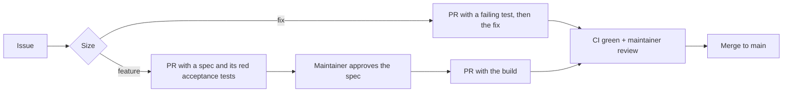

# Contributing to fact-checker

fact-checker flags fallacies, false figures, contradictions and missing context in YouTube videos while they play. Help is welcome. This page says how the project works, where help is needed and how a change gets in. The [roadmap](README.md#-roadmap) shows what comes next.

## The rules that do not change

- **False positives cost more than misses.** A noisy player gets ignored. A change that adds flags must show it does not add wrong ones.
- **Every flag cites its evidence:** the exact words, the type, a short reason and, for a figure, its source.
- **A flag is a signal, not a verdict.** It shows a confidence. It never calls anyone a liar.
- **No personal data in the repo.** Never commit real recordings, transcripts or a real person's quotes. Tests use invented dialogues (`tests/fakes/`, `tests/golden/`).
- **Everything written in the repo is in English:** code, comments, docs, commit messages. Issues and discussion can be in Spanish or English.

## Where help is needed

| Area | What is needed | Good for |
|---|---|---|
| **Review flags** | Use the extension and mark flags "Agree / Disagree" with a reason. Marks are the only way to measure quality. No code needed | anyone, especially journalists and fact-checkers |
| **Test dataset** | Invented dialogues with known fallacies, contradictions and false figures, in Spanish and English, for `tests/golden/` | linguists, logic or rhetoric teachers |
| **Official data sources** | Lists of reliable statistics offices and sources per country for the figure search. Only Spain is well covered today | economists, data journalists |
| **Track record analysis** | Detect manipulation the way a professional analyst does: compare what a public figure says with their record (past statements, votes, promises, changes of position), with citable sources | political scientists, analysts, journalists |
| **Fact-checking method** | Review how claims are picked and checked against professional practice (IFCN principles, verdict scales, ClaimReview) | professional fact-checkers |
| **Calibration from feedback** | Turn the shared marks into measured improvements (roadmap v0.4): confidence bars per flag type, labels that fail often, rule changes validated on held-out marks | statistics or ML people |
| **More languages** | Translate the extension and adapt the prompt rules (Portuguese, French, Catalan, …) | native speakers |
| **Windows** | The helper runs on macOS and Linux only | Python developers on Windows |
| **Cheap or local models** | Find which Hugging Face or Ollama models keep the precision through the `chat` provider | ML people |
| **Live streams** | Analyse live broadcasts, not only recorded videos (roadmap v0.3) | developers |
| **The web** | The public web in `src/web/`: accessibility, phone layouts, translations, the cards a guest can download | front-end developers, designers |

## How a change gets in

1. **Open an issue first** for anything bigger than a small fix, so nobody builds something that will not be merged.
2. **Fork the repo and open a pull request.** Sign each commit with `git commit -s` ([Developer Certificate of Origin](https://developercertificate.org/)).
3. **Small fix:** add a test that fails without the fix, then the fix.
4. **New feature:** the project builds features from short specs in `docs/specs/NNN-name/spec.md`.
   - First PR: the spec and its acceptance tests in `tests/acceptance/`, red.
   - The maintainer approves the spec. Then the build PR makes the tests green.
   - Never edit an approved acceptance test while its slice is open. If one looks wrong, open an issue.
   - When the last item of the slice is done, its tests move into the suite of their part (`/mini-implement <id> promote`). From then on they are ordinary tests: merge or remove one when another test checks the same behaviour.
5. **CI must be green.** It runs the same checks as below.
6. **A maintainer reviews and merges.** The maintainer has the final say while the project is small.

Feedback on flags does not need a PR: marks reach the project through the extension, after the person agrees to share them.

## Run it locally

| Step | Command |
|---|---|
| Install | follow [README.md](README.md) or [INSTALL-AGENT.md](INSTALL-AGENT.md) |
| Helper tests | `cd src/helper && uvx --quiet pytest -c pyproject.toml -q` |
| Extension and collector | `cd src/extension && npm ci && npx tsc --noEmit && npx tsc -p ../collector --noEmit && npx vitest run && npm run build` |
| Web | `cd src/web && npm ci && npx tsc --noEmit && npm run build`, then `bash tests/web/check-brand.sh` |

- **Commit the built files.** The built extension (`src/helper/fact_checker/extension/`) and the built web (`src/collector/web/app/`) are in the repo. Run the build before you commit: CI fails if either differs from a fresh build.
- **Web colours come from the brand tokens** (`src/web/brand/tokens.css`). CI fails on a hex colour in `src/web/src`.
- Tests never call a real model or a real service. They use fakes on `PATH` and local fake servers.
- Find a test by the part it checks:

| Part | Tests |
|---|---|
| Helper | `tests/helper/test_<part>.py`: reading, fact_check, judge, transcript, providers, cost, setup, sharing, summary, server, eval |
| Extension | `tests/extension/<screen>.test.ts`: card, panel, strip, settings, start, bundle |
| Collector | `tests/collector/<route>.test.ts`: marks, analyses, the public API, the review page |
| Web | `tests/web/<screen>.test.ts`: list, viewer, profile, compare, how it works |
| External systems | `tests/contracts/`: one contract test each; SKIP without credentials |
| Shared fakes and helpers | `tests/support/` (no test); recorded answers in `tests/fakes/` |
| Open slices | `tests/acceptance/` |
| Measurements on real interviews or paid models | `evals/`, one line each in `evals/README.md`; CI never runs them |
- A real analysis spends the subscription or API key of the person who runs it. Say in the PR what a real run costs, if you made one.

## Reporting

- **An unfair flag:** mark it "Disagree" with a reason in the extension.
- **A bug:** open an issue with the steps, the helper version (`fact-checker doctor`) and no transcript.
- **A security problem:** see [SECURITY.md](SECURITY.md). Do not open a public issue.

Everyone taking part follows the [Code of Conduct](CODE_OF_CONDUCT.md).
