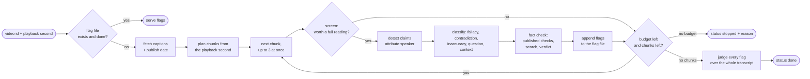

# Architecture

**RFC**: [RFC.md](RFC.md) · **Target**: [TARGET.md](TARGET.md) · **Synced**: 2026-11-22 · `06d4612`
**Pending changes**: 2 new · 3 changed (no spec: Q1 and Q2 of the next quality RFC)
> 🟢 new · 🟡 changed · 🔴 removed — the code does not match these lines yet.

A Chrome extension shows flags on the YouTube player. A Python helper on the person's machine turns a video into flags and caches them per video. The person's state lives in the helper home, outside the repo. With the person's consent, marks and whole analyses go to the owner's collector, a Cloudflare Worker with a D1 database. The same Worker gives the owner a review page, and serves a public JSON API of approved analyses and the public web.

## Components

| Component | Job | Path | State |
|---|---|---|---|
| Extension | Reads the video id and playback second on youtube.com; polls the helper; draws flags on the player, the side panel and the strip under the video; asks for consent once, takes votes on cards, and holds the ⚙ settings (language, sharing, quiet mode); texts in Spanish and English | `src/extension/` (texts in `src/extension/src/texts.ts`, `_locales/`); built copy in `src/helper/fact_checker/extension/` | `chrome.storage`: viewer settings |
| Helper server | Localhost HTTP API, reached only through the host `127.0.0.1:<port>` and from the extension, its own pages or a local program (no Origin): a web page gets 403: starts and follows an analysis, serves the flag file and the summary, keeps marks, reads and writes the sharing answer; picks the provider of each role from `config.toml`; after a whole analysis or a mark, sends it to the collector if sharing is on | `src/helper/fact_checker/server.py` | none |
| CLI | `serve`, `analyze <url>`, `eval [--save\|--marks]`, `judge <id> [--against-marks]`, `setup`, `doctor [--json]`, `key set <NAME>`, `feedback send\|pull`, `shared list\|approve [--install <id>]\|reject`, `prompts` (prints the prompts file of this helper version), `compare <id> [<id> <id>] [--swap]` (one id: a debate; `--swap`: its thumbnail halves change sides), `provider [<name>]` | `src/helper/fact_checker/cli.py` | none |
| Pipeline | A stream of caption chunks in, flags out. Each chunk is analysed with the text before it as context, so a recorded video and a live stream use the same code. A scheduler orders the chunks and guards the budget of each role. Prompts follow the spoken and the reader language (`core/languages.py`). Prices per model in `core/prices.py`. No I/O | `src/helper/fact_checker/core/` | none |
| Transcript adapter | Captions and publish date through yt-dlp; audio + local Whisper when captions are missing | `src/helper/fact_checker/adapters/youtube.py`, `whisper.py` | none |
| Speaker adapter | Separates the voices of the audio on the laptop and gives each caption word its voice | `src/helper/fact_checker/adapters/diarization.py` | none |
| LLM adapter | Runs a prompt with a JSON schema through `claude -p` on the subscription; or through `codex exec` on a ChatGPT subscription, chosen by `FACT_CHECK_PROVIDER` (`claude` by default, or `codex`); or through the Anthropic Messages API, an OpenAI-compatible Responses API, or any Chat Completions API (`chat`) on an API key. `<helper home>/config.toml` picks the provider and the model of each role (`parts`, `verdict`, `judge`, `search`, `screen`), with `[roles.<role>]` for one role on its own provider; `FACT_CHECK_PROVIDER` overrides the provider of every role. A `claude -p` or `codex exec` reading starts without the keys of `<helper home>/.env` | `src/helper/fact_checker/adapters/llm_claude_cli.py`, `llm_codex_cli.py`, `llm_anthropic_api.py`, `llm_openai_api.py`, `llm_chat_api.py`; prices in `core/prices.py` | none |
| Fact-check adapter | Searches published fact-checks (Google Fact Check Tools API) | `src/helper/fact_checker/adapters/factcheck_google.py` | none |
| Flag store | One flag file per video | `src/helper/fact_checker/store.py` | `~/.fact-checker/videos/<video_id>.json` |
| Golden dataset | Synthetic Spanish dialogues with planted errors and expected flags | `tests/golden/` | versioned |
| Screen | A cheap reading that says whether a part gets the full reading | `src/helper/fact_checker/core/pipeline.py` (`screen`) | none |
| Judge | One reading of the whole transcript that rules on every non-context flag before the file says done | `src/helper/fact_checker/core/judge.py` | none |
| Search adapter | Web search results for a search role with no web search of its own (Tavily) | `src/helper/fact_checker/adapters/search_tavily.py` | none |
| 🟡 **CHANGED** Summary | Builds the profile card of each guest of a video and the comparison card of up to three people (of one debate, or of up to three interviews), with true and unverifiable claims apart, and renders each as a PNG with its alt text | `src/helper/fact_checker/core/summary.py`, `summary.html`, `adapters/screenshot.py`, `adapters/thumbnail.py`, `cli.py` | `~/.fact-checker/thumbnails/` |
| Feedback | Sends each mark to the collector after consent; keeps the sent record and the install id; `feedback send` and `feedback pull` | `src/helper/fact_checker/feedback.py` | `~/.fact-checker/install-id`, `feedback-sent.json`, `feedback/` |
| Shared analyses | Uploads a whole analysis stripped to the shared fields, with each guest's summary, each person's speaking time, turns and longest turn, the voice turns by person (from the local voice turns), and the helper version that names its prompts; downloads an approved one; the owner's list, approve and reject | `src/helper/fact_checker/analyses.py` | none |
| Install | `setup`, `doctor`, `key set`, `provider`: checks the tools, writes `config.toml` and `.env`, copies the extension, starts the helper at login, switches the provider | `src/helper/fact_checker/install.py`, `install.sh`, `INSTALL-AGENT.md` | `~/.fact-checker/config.toml`, `.env`, `extension/` |
| Collector | Cloudflare Worker: keeps the marks of testers and web viewers, the shared analyses, hidden flags, prompts and feedback; serves only approved analyses, the owner's review page, the public API and the web app with its share meta; redirects old `/try/` links to the viewer; counts visits per day; hard stops per install id and per day | `src/collector/` | D1 database `fact-checker-feedback` (`schema.sql`) |
| Review page | `/admin` behind Cloudflare Access: pending uploads with models per role, cost, type, flags and serious flags; approve the upload opened (never a later one), with each flag's sources and each guest's tally, reject, hide a flag; swap a debate's face halves; set a video's own display title; turn a video off or on for the public; marks, feedback and visits | `src/collector/web/admin/` | none |
| Web app | The public web in React: the home page, the viewer, the video list with its sort, filters and grid, a guest's profile with its downloadable card (drawn in the browser), the comparison and how it works (with the project's roadmap, one step per version), in Spanish and English, with the CALVET brand; reading pages share one frame (header with its pill bar, footer, tooltip); a guest's image comes from the video's thumbnail; what the reader watched and their list view stay in the browser | `src/web/`, built to `src/collector/web/app/` | none |
| Panel logic | The flag lit at a second and the order of flags, with no DOM; the extension and the web app share it | `src/shared/panel.ts` | none |
| Video titles | The title a reader sees: no leading live tag, Spanish sentence case, the names of our own data restored; the collector serves it as `display_title` (the owner's own title wins, table `titles`), the raw `title` stays | `src/shared/titles.ts` | none |
| Verdict kinds | The verdict kind of a flag (Falso, Engañoso, Retórica, Evasiva, Puntualización, Contexto); the collector's counts and the web app share it | `src/shared/kinds.ts` | none |
| Web feedback | The browser's anonymous web id, the stored consent answer, and sending a web mark and a flag comment; the web app uses it | `src/shared/feedback.ts` | browser storage: `fc-web-id`, `fc-share` |
| Prompt export | The helper's prompts as JSON, with ids per component and rule, one file per helper version | `src/helper/fact_checker/prompts.py` | none |

- The helper home is `~/.fact-checker/`, or the folder in `FACT_CHECKER_HOME` (tests use a temporary one). It holds `videos/`, `captions/`, `thumbnails/`, the logs, `marks.jsonl`, `config.toml`, `.env` (keys, mode 600), `extension/`, `install-id`, `feedback-sent.json` and `feedback/`.
- Flag files hold quotes from real videos: they stay in the helper home, never in the repo.
- The helper logs each Claude tool call to `~/.fact-checker/usage.log`: date, video id, step, duration, and the lead: how many seconds the chunk was ready before playback reached it. One JSON line each: `ts`, `video_id`, `step`, `chunk_start`, `duration_s`, `lead_s`. One line per Claude reading, with `step` `speakers`, `analyze_chunk`, `search`, `fact_check` or `judge` (`chunk_start` and `lead_s` null outside a part), plus `input_tokens`, `cache_creation_input_tokens`, `cache_read_input_tokens`, `output_tokens`, `cost_usd` (the API-equivalent `total_cost_usd` of `claude -p`) and `model`. A part reading of the `conversation` mode also has `session`, the id of the Claude Code session it continues. A resumed session reports the cost of the whole conversation, so such a reading logs the difference from the previous one.
- A fallacy outside the closed list is never shown; the helper writes it to `~/.fact-checker/candidates.log` for the person to review.
- 🟡 **CHANGED** The helper logs each claim taken from a part to `~/.fact-checker/claims.jsonl`, one JSON line each: `video_id`, `t`, `speaker`, `outcome` (`flagged`, `ok`: a verdict and no flag, `unchecked`: no verdict, no fact-check or refused by the budget; `skipped`: not central to the speaker's argument, never checked; `repeated`: the same figure as a claim checked earlier in the video, whose second is in `repeats`), and `verdict` on a checked claim (`true`, `mostly_true`, `unverifiable`, `misleading`, `false`). No quote, so it holds no transcript. It tells whether a missed figure was never extracted or was checked.
- The person's marks go to `~/.fact-checker/marks.jsonl`, one JSON line each: `video_id`, `flag_id`, `quote`, `type`, `label`, `confidence`, `verdict`, `reason`, and `shared: false` when given with sharing off (such a mark never leaves the machine); never in the repo.

## Dependencies

| From | To | Kind |
|---|---|---|
| Extension | Helper server | HTTP on localhost |
| Helper server, CLI | Pipeline, Flag store | calls |
| Pipeline | LLM port, Transcript port, Fact-check port | calls through ports |
| Adapters | Pipeline types | implements ports |
| Helper server | Feedback, Shared analyses | calls |
| CLI | Install, Feedback, Shared analyses | calls |
| Feedback, Shared analyses | Collector | HTTPS, JSON |
| Pipeline | Search port | calls through ports |
| Web app | Collector | HTTPS, JSON, same origin |
| Web app | YouTube IFrame Player API | iframe, JS |
| Web app | YouTube thumbnail | HTTPS image, CORS |
| Web app, Extension | Panel logic | imports |
| Web app, Test page | Web feedback | imports |
| Review page | Cloudflare Access | identity of the owner |

## One run



- Chunks start at the playback second and run forward, then the earlier part. The first chunk is 30 seconds, the others 2 minutes, so the first flags arrive within seconds.
- Started from the extension, the analysis follows the playback second that each poll carries. No chunk starts more than 10 minutes after the last second heard. After 60 s with no poll (the tab closed) the analysis pauses, and the next poll resumes it. A jump plans again from the new second with a 30-second chunk; the skipped stretch and the part before the start second are analysed only once watched. The analysis is done once every chunk from the playback second to the end is done. Started without the extension (command line, a check), it reads the whole video as before.
- Up to 3 chunks run at once.
- With `HF_TOKEN`, the voices are separated and named in the background: the chunks never wait for them (at most 1 s after the captions, so voices ready at once name the first chunk). Until they come, a chunk names the speakers from the text; the chunks read after use the voices, and every flag already in the file takes the name of the voice heard at its second (id unchanged). The file says `done` only once the voices are known. A failed separation writes a `speakers` usage line with its reason and keeps the text names. The first chunk keeps the screen.
- `POST /videos/<id>` starts again an analysis whose `stop_reason` starts with `error`; a `budget` stop stays. The panel tab says "Preparando el análisis…" until `first_flags_s` is in the file, and a stopped analysis shows its reason in one line on the player.
- A chunk gets what was said before it in one of two context modes (`CONTEXT_MODE` in `server.py`). `conversation` is the default. A `chat` parts provider always reads `window`: a chat API resends the whole conversation, mostly with no cache:
  - `window`: the 3 minutes before it and the positions list, in its own reading.
  - `conversation`: one Claude Code session reads the chunks in plan order, one at a time; each reading resumes it and sends only its chunk. Over 150k tokens of context, a new session starts and its first reading gets the positions list.
  - An earlier quote of a contradiction or a question is found anywhere in the transcript before the chunk.
- Before its full reading, a cheap model (role `screen`: `haiku`, `claude-haiku-5-5`, `gpt-6-luna`; Codex the account default; `chat` the parts model) reads the chunk alone and answers `read` and a `reason`. Only an explicit `read: false` skips the chunk; an error or another answer reads it. A skipped chunk adds no position; in a conversation its words go as CONTEXT in the next chunk's message. Each screen reading is a `screen` usage line with `read` and `reason`. The screen spends a budget of its own, the size of the part budget. `screen = false` in `config.toml` turns it off, for a measurement.
- Every reading asks for medium effort and the five-minute cache (`FORCE_PROMPT_CACHING_5M=1`). The search reading may use WebSearch, at most 2 searches per claim, and never opens a page. A reading outside a conversation keeps no session on disk.
- Each chunk also gets the positions list: what each speaker stated in the chunks done before it starts, earlier in the video, one line each (`Invitado (3:00): summary «quote»`). The same part tool call returns the new positions, so the list adds no tool call. Over 60 lines, the oldest line of a speaker takes in their next one, without quotes. A contradiction can quote an earlier position from anywhere in the video.
- A contradiction flag carries the time of the second utterance.
- The part tool call marks each claim `central` or not, and names a claim that repeats one already checked in the video (the list of checked claims is in its prompt). Only central, new claims go to the fact-check, so each figure is checked once per video. With 3 parts at once, a repeat of a claim still in flight is checked again.
- The fact-check is two readings: Haiku with WebSearch (S18: no WebFetch) gathers the evidence of the part's claims, then Opus with no tools turns it into verdicts. A verdict cites only urls of the evidence or of the published fact-checks. Without a search LLM (`run_analysis` without `searcher`, `fact-checker eval`), one reading searches and judges.
- The fixed rules of the part and fact-check tool calls go in the system prompt, the same text in every reading, so they are read from cache; the part data goes in the prompt. The part tool call returns at most 2 context cards.

## Contracts

**Flag file** (`~/.fact-checker/videos/<video_id>.json`, served by `GET /videos/<id>` with the latest `mark` added to each flag)

```json
{
  "video_id": "abc123",
  "published_at": "2026-11-13",
  "status": "running",
  "stop_reason": null,
  "analysed_until": 270.0,
  "flags": [
    {
      "id": "f1",
      "t": 754.2,
      "speaker": "guest",
      "quote": "exact words of the utterance",
      "type": "fallacy",
      "label": "ad_hominem",
      "reason": "one short sentence",
      "confidence": 0.86,
      "related": { "t": 120.5, "quote": "earlier words" },
      "sources": [{ "publisher": "INE", "url": "https://…", "date": "2026-10-01" }],
      "note": null
    }
  ]
}
```

| Field | Values |
|---|---|
| `status` | `running`, `done`, `stopped` |
| `title`, `channel`, `duration` | from yt-dlp with the publish date; `duration` in seconds, null for a live stream |
| `cost_usd` | the sum of `cost_usd` of every Claude reading of the video so far, as in the usage log |
| `spoken`, `lang` | `spoken`: the video's language, `es` or `en`, from the caption track read (`es-orig`, `en-orig`, `es`, `en`) or the speech engine; `lang`: the language of every `reason`, `note`, judge reason and of the shareable summary, from the analyze request, else `spoken`. Quotes stay in `spoken`; label ids are the same in both languages |
| `analysed_until` | the end of the parts done without a gap from the start second (S18: from the playback second last heard); a stretch with no caption is no gap; starts at that second |
| `type` | `fallacy`, `bias`, `contradiction`, `inaccuracy`, `question`, `context` |
| `label` | fallacy: `ad_hominem`, `tu_quoque`, `false_dilemma`, `straw_man`, `false_cause`, `hasty_generalization`, `vague_authority`, `insinuation`, `double_standard`, `cherry_picking`, `appeal_to_fear`; inaccuracy: `false`, `misleading`, `disputed`, `definition_swap`, `plan_as_fact`; contradiction: `self`, `record` (the speaker's earlier public statement), `promise` |
| `measures` | inaccuracy: each credible measure of the figure, `{name, value, source, tier, supports}`; required for `disputed` |
| `controversy` | inaccuracy: one sentence on a documented controversy about the metric, with its source, else null |
| `answer` | question only: `answered`, `partial` or `dodged`; `t` is the end of the answer, `related` holds the question |
| `related` | contradiction, straw man and question: the earlier utterance; for a contradiction with the record, also its `date` and `source` |
| 🟡 **CHANGED** `sources` | inaccuracy, contradiction `record` or `promise`, and a `context` flag from an insinuation with a public basis: required; others: empty |
| `promise` | contradiction `promise` only: `{made, figure, deadline, status}`; `made` is `YYYY-MM`, `status` is `met`, `partly met`, `not met` or `in progress`; only `partly met` and `not met` make a flag |
| `note` | inaccuracy: the updated value when the data changed after `published_at` |
| `on_player` | `true` when the confidence reaches the bar of the flag's type |
| `judge` | non-context flags, once every part is done and before `status` says `done` (on in the helper and in `fact-checker judge <id>`, off by default in `run_analysis`): `{verdict: keep\|nitpick\|drop, reason, speaker?}` from one Opus reading per started 2 video-hours of the whole transcript with speakers. The judge rules only `keep` or `nitpick` (a "puntualización", for a small slip of any flag type), and any other answer is `keep`; `drop` remains only in files judged before S32. `speaker` only when the line belongs to someone else. The found flag stays, so the judge is reversible. Absent when the judge fails. A `mark` wins: a flag marked `correct` shows as found, under the judge's speaker The verdict carries `severity?`: `minor`, `moderate` or `serious` by a published rubric (materiality, centrality, magnitude; never intent), only on a `keep`; a file judged before S34 has none. The judge reads the transcript and the flags with each speaker's name replaced by a role and a number ("Invitado 1"). `fact-checker judge <id>` reads twice; the strictest ruling of each flag wins: keep over nitpick, then the higher severity |
| `first_flags_s` | seconds from the start of the analysis to the first chunk written; absent until then; not in a shared copy |
| `source` | `shared` when the file came from the author's collector (another person's whole analysis in the viewer's language); absent for an analysis made here |
| `speakers` | the name of each voice of the transcript |
| `people` | per speaker name `{role: host\|guest, person, spoken_s, set_by: llm\|person}`: `person` is the canonical name that matches one person across videos; `spoken_s` the seconds of speech |
| `readers` | the provider and model of each role that read the video, `{parts: {provider, model}, …}`; absent in older files |
| `mark` | on `GET` only, never in the file: the person's latest verdict on the flag, `correct` or `unfair`; absent with no mark |

**Helper HTTP API** (localhost only)

| Request | Purpose |
|---|---|
| `POST /videos/<id>?from=<seconds>&lang=<es\|en>` | Start an analysis at the playback second if no flag file exists; `lang`, the extension's interface language, goes into the flag file (any other value: 400) |
| `GET /videos/<id>?at=<seconds>` | Return the flag file so far, each flag with its latest `mark` from `marks.jsonl`. `at`, the playback second, moves and resumes a running analysis; the extension sends it on every poll. With `lang` and no local file, the helper first asks the collector `GET /analyses/<id>?lang=` (no install id, 5 s) and keeps what it gets with `source: "shared"`; else 404 |
| `POST /videos/<id>/marks` | Keep the person's mark on one flag: `{flag_id, verdict: correct\|unfair, reason}`; with sharing on, the helper sends it to the collector in the background |
| `POST /videos/<id>/people` | The person sets the role of one speaker: `{name, role}`; `set_by` becomes `person` |
| `GET /videos/<id>/summary.png?person=<name>[&swap=1]` | The profile card of one guest: 1080×1350; in a debate (two guests) the cover shows the guest's half of the thumbnail, the first guest the left half unless `swap=1`, the flags the judge keeps (a mark wins: `unfair` counts nowhere), rendered by headless Chrome in the layout of the CALVET board `InterviewCard`; all text ≥ 30 px |
| `GET /videos/<id>/summary.txt` | The alt text of the image, at most 1000 characters |
| `GET /videos/<id>/summary` | A page with the image and its alt text ready to copy; the extension opens it in a new tab |
| `GET /share` | The sharing answer: `{share: true\|false\|null}`; null until the person answers |
| `POST /share` | `{share: bool}`: writes `share_marks` into `config.toml` (any other body: 400) |
| `GET /provider` | The provider of the parts role, `{provider}`, for the spend line under the analyse button |
| `GET /health` | `{app: "fact-checker", version, pid, home, writable, tools}`: doctor, setup and the extension tell the helper from another program on the port; `writable` is false when the helper cannot write its home (a start inside an agent's sandbox). `tools`: `{<provider command>, uv, yt-dlp, ffmpeg: true\|false}`, found on the helper's own PATH; doctor turns a tool the terminal finds but the helper does not into "the helper does not find <tool>" · fix `fact-checker setup` |
| `GET /keys`, `POST /keys` | The key page: each key the roles need plus `HF_TOKEN` and `FACT_CHECK_API_KEY`, as "falta" or "guardada", each with a hidden field. A POST (form: `name`, `value`) writes `.env` with the `key set` writer and sets the key in the running helper, so the next analysis uses it with no restart. Host must be `127.0.0.1:<port>` and a POST's Origin `http://127.0.0.1:<port>`, else 403; another name or a value with a line break gives 400. No answer holds a key value. The extension's ⚙ → Claves opens it on the found port |

**Collector API** (`src/collector/src/index.ts`; tables in `schema.sql`)

| Request | Caller | Purpose |
|---|---|---|
| `POST /marks` | a tester's helper, or the web app or the test page after consent | Keeps up to 500 marks (256 KB) of one install id; a mark sent again replaces its row; 20 accepted requests per install id per UTC day, then 429; the marks of all ids stop at 5,000 a UTC day, counted in `requests` under the id `all`; every write outside `/admin` also stops at 30 a minute per address |
| `GET /marks?since=<ISO time>` | the owner, `Authorization: Bearer <ADMIN_TOKEN>` | The rows received after that time; 401 without the token |
| `PUT /analyses/<video_id>?lang=<es\|en>` | a helper, after a whole analysis | `{install_id, analysis, prompts?}`: status `done`, ≤ 1 MB, ≤ 1,000 flags, http(s) links only. Without the token: pending (202); with it: served (201, or 200 when it replaces). 409 when the served analysis's parts model ranks equal or higher (opus > sonnet > haiku > other); 10 uploads per install id per UTC day |
| `GET /analyses/<video_id>?lang=` | any helper, no install id | The approved analysis without its hidden flags, or 404 |
| `GET /analyses` | the owner | The pending uploads, with `readers`, `cost_usd`, type (`debate` with two or more guests, else `interview`), flags and serious flags |
| `POST /analyses/<video_id>/approve\|reject?lang=` | the owner | Serve the best pending upload, or delete the pending ones |
| `DELETE /analyses/<video_id>?lang=` | the owner | Remove a served analysis |
| `GET /admin` | the owner, through Cloudflare Access | The review page |
| `/admin/*` | the review page, through Cloudflare Access | The page's own calls (pending list, open, approve, reject; `/admin/approved` and `/admin/approved/<id>`, the approved videos (with `guests`, their count, and `swap`) and one in full; `/admin/hidden/<id>`, its hidden flag ids; `POST /admin/analyses/<id>/flags/<flag_id>/hide\|show`; `POST /admin/videos/<id>/active/on\|off`, the switch "Visible en la web": a row of `inactive` per video, for every language; an off video leaves `/api/videos` and its `/api/videos/<id>`, flags and visits answer 404, its share tags turn neutral, and `/admin/approved` still lists it with `active: false`; 404 when the video is not approved; `POST /admin/videos/<id>/faces/swap\|keep`, the switch "Caras: intercambiar izquierda/derecha": a row of `faces` per video, for every language, 404 when the video is not approved; `/admin/marks` and `/admin/feedback`, the latest 200 rows of each, newest first); Access covers only `/admin*`, so the Worker checks the Access JWT here, not `ADMIN_TOKEN` |
| `POST /analyses/<video_id>/flags/<flag_id>/hide\|show?lang=` | the owner | Hide a flag, or show it again: a row of `hidden` (video, lang, flag id), so it holds for the pending upload, once approved, and after a re-upload; 404 when neither the approved analysis nor a pending upload holds that flag id |
| `GET /api/videos` | anyone | Approved videos: `video_id`, `langs`, `title`, `channel`, `duration`, `published_at`, `type`, `guests`, `swap` (true when the owner swapped the halves of the debate's thumbnail, so the first guest is the right half; else false), `flags` (count), and `counts`: `{falso, enganoso, retorica, evasiva, puntualizacion, contexto}`, the flags by verdict kind without the hidden ones and those the judge dropped. An aviso is every kind but `contexto` (chat) |
| `GET /api/videos/<id>?lang=` | anyone | The video fields, `swap` among them; `lang` served and `requested` when only another language exists; the `prompts` version, null when the collector has no file for it; `summary` (S4): per guest `{checked, verdicts: {false, misleading, nitpick, correct}, severity: {serious, moderate, minor}, devices: [{label, count}], dodged, partial, asked, gravest: [<flag id>, <flag id>]}`, the sums of the upload's tallies; null for an upload without one. `correct` is `checked` less the other verdicts; `devices` by count, ties to more serious flags; a device `label` is a rule id; `people` (S5): per person `{role, spoken_s, turns, longest_s}`, null for an upload without voice turns; `turns` (S5): the voice turns `[{start, end, person}]`, null likewise |
| `GET /api/videos/<id>/flags?lang=&after=<cursor>` | anyone | `{flags, cursor, live}`: the flags after the cursor, in order, never a hidden one. A recorded video answers every flag and an end cursor; `live` is false until live streams |
| `GET /`, `/es/*`, `/en/*` | anyone | The web app's HTML, `noindex` until the web goes public; `/` sends to `/es/` or `/en/` by the browser's language. On `/<lang>/v/<id>` the Worker writes the video's title and YouTube thumbnail into the share meta and counts a visit. Pages: `/<lang>/` (the home page, S12), `/<lang>/videos` (the list, S12), `/<lang>/v/<id>`, `/<lang>/v/<id>/<guest>`, `/es/v/<id>/comparar`, `/en/v/<id>/compare`, `/es/como-funciona`, `/en/how-it-works` |
| `POST /api/visits` | the web app | `{video_id, lang, kind: "seek"}`: adds one to that day's counter; no cookie, no per-person id |
| `GET /admin/visits` | the review page, through Cloudflare Access | Visits and seeks per video, language and day: `{rows: [{video_id, lang, day, visits, seeks}]}` |
| `GET /try/<video_id>` | anyone | A redirect to `/<lang>/v/<video_id>` |
| `GET /api/prompts/<version>` | anyone | The prompts file of that version, only when an approved analysis names it, else 404 |
| `POST /api/feedback` | the web app or the test page after consent | One feedback row (≤ 8 KB): a `prompt` row needs an approved version, a component of its prompts file, a rule of that component if named, and a quote found in that rule's or component's text, else 400; 20 rows per id and 1,000 for all ids per UTC day, then 429 |
| `GET /feedback?since=<ISO time>` | the owner | The feedback rows received after that time |

- A sent mark holds: video, second, type, label, quote (≤ 1,000 characters), confidence, verdict, reason (≤ 500), provider, model, helper version (`web` from the web page), install id. Rows hold no name, email, IP or path.
- A shared analysis holds only `video_id`, `lang`, `spoken`, `status`, `published_at`, `title`, `channel`, `duration`, `speakers`, `people`, `claims`, `questions`, `readers`, `cost_usd`, `analysed_until`, `flags`, `summary` (per guest name, `summary.tally`: `{checked, asked, flags: {<flag id>: {verdict, severity, device, question}}, gravest: [<flag id>…]}`; a flag that adds to nothing is left out, and `gravest` lists every candidate in order, so the Worker sums the flags that are not hidden) and `helper_version`, which names its prompts. `claims`: per speaker name `{checked, correct, unverifiable}`, the tally of `claims.jsonl`; `questions`: per speaker name, the number of questions put to them; numbers only.
- **Prompts file**: `{version, components: [{id, role, text, rules: [{id, text}]}]}`. `version` is `<package version>+<the first 12 hex digits of the SHA-256 of the compact JSON of components>`, so a changed prompt changes it; the shared analysis's `helper_version` is that version. Rule ids are unique in the file; a flag's rule is the rule whose id is its `label` (the verdict rules live once, in `verdict`).
- **Feedback row**: `{id, kind: flag|prompt, video_id?, flag_id?, rule?, version?, component?, quote?, text (≤ 1,000 characters), install_id, received_at}`.
- **Cursor**: an opaque string; the client sends back the last one it got. It marks a position in the flag list, so flags appended by a live stream keep it valid; a cursor the API never gave is refused (400).
- **Public API headers**: every `/api/*` answer carries `Access-Control-Allow-Origin: *` and `Cache-Control: public, max-age=60`; no other route is cached (docs/research/workers-caching.md, chat).
- **Examples**: `docs/api-examples/` holds the answers of an invented debate and an invented interview, in the shapes of the real API; no real name, quote or video id.

**Settings file** (`<helper home>/config.toml`; `fact-checker setup` writes it from `config.example.toml`)

| Key | Values |
|---|---|
| `provider` | `claude` (default), `codex`, `anthropic`, `openai`, `chat` |
| `feedback_url` | the collector address; none: nothing is sent |
| `share_marks` | `true`, `false`; absent: not asked yet, nothing is shared |
| `screen` | `false` turns the screen off, for a measurement |
| `[models]` | `parts`, `verdict`, `judge`, `search`, `screen`: a model per role |
| `[anthropic]`, `[openai]`, `[chat]`, `[tavily]` | `base_url`, `key_env` |
| `[roles.<role>]` | `provider`, `base_url`, `key_env`, `model` for one role |

**Ports** (Pipeline)

| Port | Function |
|---|---|
| LLM | `complete(prompt, schema, tools=()) -> dict` |
| Transcript | `fetch(video_id) -> Transcript(segments[t, text], published_at, language, speakers)` |
| Search | `search(query) -> list[{title, url, content, published_date}]` |

**Pipeline interface**

| Function | Purpose |
|---|---|
| `plan(transcript, from_t) -> list[Chunk]` | Orders the chunks from the playback second |
| `analyze_chunk(chunk, context, ports, positions, checked, session, said) -> ChunkResult` | Flags, claims and new positions of one chunk; `context` is the text before it, `positions` what the speakers stated earlier in the video. with a `session`, the chunk is the next message of that conversation; `said` is all text before the chunk, where earlier quotes are found. A live stream calls it with a rolling window |
| `screen(chunk, llm, …) -> {read, reason}` | Whether a part gets the full reading; only an explicit `read: false` skips it |
| `judge(flags, transcript, llm, reader) -> {flag_id: {verdict, reason, speaker?}}` | The judge's verdict on every non-context flag |
| Fact-check | `search(claim, language) -> list[PublishedCheck]` |

**Display rule**: a flag goes on the player when its confidence reaches the bar of its type in `src/helper/fact_checker/thresholds.json` (for another provider, `thresholds.<provider>.json`; with no such file, every bar is 0.8); the helper writes the result in `on_player`. `fact-checker eval --save` sets the bars of the provider in use from the golden dataset: the lowest confidence with precision ≥ 0.80, or `null` (never) with fewer than 5 flags. Flags under the bar go to the side panel. The viewer can narrow the rule with quiet mode (serious flags only; a flag not yet judged shows at confidence ≥ 0.9) and pin a card past its 8 seconds; both live in the extension only.

## Seams

| Component | Public interface | Test through |
|---|---|---|
| Pipeline | `plan`, `analyze_chunk` | Golden dataset with a fake LLM for unit cases; the real LLM in `eval` |
| Helper server | HTTP API above | An integration test with fake ports |
| Adapters | Their port | A recorded, sanitized response of each system |
| Extension | Flag file in, DOM out | A test page that mimics the player with a fixed flag file |
| Collector | Its HTTP routes | vitest with Node's built-in SQLite as the D1 binding (`tests/support/d1_fake.ts`); a contract test against the deployed Worker |
| Feedback, Shared analyses | `feedback.py`, `analyses.py` functions | a fake collector (`tests/support/marks_fakes.py`, `shared_analysis_fakes.py`) |
| Install | `install.sh`, `setup`, `doctor --json` | fake commands on PATH and a temporary HOME |
| Test page | API answer in, panel DOM out, seek out | vitest with a fake IFrame player and a fixed API answer |
| Web app | `mount(root, Player)` in `src/web/src/main.tsx`: API answer in, DOM out, seek out | vitest with jsdom, the fake collector of the public API and a fake IFrame player |

Tests live by part, not by slice:

| Folder | Holds |
|---|---|
| `tests/acceptance/` | The acceptance tests of an open slice, untouched while it is open |
| `tests/helper/test_<part>.py` | One suite per part of the helper: reading, fact_check, judge, transcript, providers, cost, setup, sharing, summary, server, eval |
| `tests/extension/<screen>.test.ts` | One suite per screen: card, panel, strip, settings, start; and the shipped bundle |
| `tests/web/<screen>.test.ts` | One suite per web screen: list, viewer, profile, compare |
| `tests/collector/<route>.test.ts` | One suite per route: marks, analyses |
| `tests/contracts/` | One contract test per external system; it says SKIP without credentials |
| `tests/support/` | Shared fakes and helpers, no test; recorded answers stay in `tests/fakes/` |
| `evals/` | Runs on real interviews or paid models, with a line each in `evals/README.md`; CI never runs them |

When the last item of a slice is done, `/mini-implement <id> promote` moves its tests into the suite of their part. There they can be merged or removed like any other test. Each test keeps its `S<n> A<n> · <title>` header as a comment.

## External systems

| System | Used for | Interface | Auth | Contract source | Owner | Status | Test double |
|---|---|---|---|---|---|---|---|
| YouTube via yt-dlp | Captions, publish date, audio (16 kHz mono WAV) | CLI / Python library | none | [external-contracts.md](archive/001-personal-fact-checker-for-recorded-youtube-videos/research/external-contracts.md) | yt-dlp project / YouTube | confirmed | invented captions: `tests/fakes/youtube/` |
| Claude Code (`claude -p`) | LLM calls and web search | CLI, headless | the person's subscription login | [external-contracts.md](archive/001-personal-fact-checker-for-recorded-youtube-videos/research/external-contracts.md) | Anthropic | confirmed | recorded fake: `tests/fakes/claude-code/` |
| Google Fact Check Tools API | Published fact-checks (ClaimReview) | REST | API key in header `X-goog-api-key`, from `FACT_CHECK_API_KEY` | [external-contracts.md](archive/001-personal-fact-checker-for-recorded-youtube-videos/research/external-contracts.md), [API reference](https://developers.google.com/fact-check/tools/api/reference/rest/v1alpha1/claims/search) | Google | confirmed | recorded fake: `tests/fakes/google-factcheck/` |
| pyannote (Hugging Face) | Separates the voices of the audio | Python library, model `pyannote/speaker-diarization-community-1` | read token in `HF_TOKEN` | [external-contracts.md](archive/001-personal-fact-checker-for-recorded-youtube-videos/research/external-contracts.md) | pyannote / Hugging Face | confirmed | fake: `tests/fakes/pyannote/` |
| Whisper (mlx-whisper) | Speech to text when a video has no usable captions | Python library, model `mlx-community/whisper-large-v3-turbo`, Apple silicon | none | [external-contracts.md](archive/001-personal-fact-checker-for-recorded-youtube-videos/research/external-contracts.md) | ml-explore / OpenAI (model) | confirmed | fake: `tests/fakes/whisper/` |
| Whisper (faster-whisper) | Speech to text when a video has no usable captions, on an Intel Mac or Linux | Python library, model `large-v3-turbo` (`mobiuslabsgmbh/faster-whisper-large-v3-turbo`), CPU int8 | none | [faster-whisper.md](research/faster-whisper.md) | SYSTRAN / OpenAI (model) | confirmed | the Whisper fake: `tests/fakes/whisper/` (same words) |
| YouTube thumbnail (`i.ytimg.com/vi/<id>/maxresdefault.jpg`, then `hqdefault.jpg`) | The hero image of the summary, embedded as a data URI; kept in `~/.fact-checker/thumbnails/`; a gradient when missing. In the web app, the guest's image (viewer cards, profile cover, 4:5 card), read with CORS (`access-control-allow-origin: *`, observed 2026-11-22) | HTTPS GET | none | public URL | YouTube | confirmed | none (the S14 A2 test runs without it) |
| Headless Chrome | Turns the summary page of a video into a PNG | CLI, `--headless --screenshot` | none | [external-contracts.md](archive/001-personal-fact-checker-for-recorded-youtube-videos/research/external-contracts.md) | Google | confirmed | fake: `tests/fakes/headless-chrome/` |
| Codex CLI (`codex exec`) | LLM calls and web search when `FACT_CHECK_PROVIDER=codex` | CLI, headless, JSON Lines events | the person's ChatGPT login (`codex login`) | [codex-cli.md](research/codex-cli.md) | OpenAI | confirmed (docs; no answer observed yet: the login on the laptop has expired) | docs-built fake: `tests/fakes/codex-cli/`, to re-record |
| Anthropic Messages API (`POST /v1/messages`) | LLM calls and web search when `provider = "anthropic"` | REST, JSON | API key in header `x-api-key`, from `ANTHROPIC_API_KEY` (or `key_env`) in the environment or `<helper home>/.env` | [Structured outputs](https://platform.claude.com/docs/en/build-with-claude/structured-outputs), [Web search tool](https://platform.claude.com/docs/en/agents-and-tools/tool-use/web-search-tool), [Prompt caching](https://platform.claude.com/docs/en/build-with-claude/prompt-caching), [Pricing](https://platform.claude.com/docs/en/about-claude/pricing), read 2026-11-15 | Anthropic | confirmed (docs; no answer observed: no key in the build session) | docs-built fake: `tests/fakes/anthropic-api/`, to re-record |
| OpenAI Responses API (`POST <base_url>/responses`) | LLM calls and web search when `provider = "openai"`: OpenAI, or xAI Grok with `base_url = "https://api.x.ai/v1"` | REST, JSON | `Authorization: Bearer <key>`, the key from `key_env` (`OPENAI_API_KEY` by default) in the environment or `<helper home>/.env` | [Responses create](https://developers.openai.com/api/reference/resources/responses/methods/create), [Web search](https://developers.openai.com/api/docs/guides/tools-web-search), [Structured outputs](https://developers.openai.com/api/docs/guides/structured-outputs), [Conversation state](https://developers.openai.com/api/docs/guides/conversation-state), [Pricing](https://developers.openai.com/api/docs/pricing), [xAI Responses](https://docs.x.ai/developers/rest-api-reference/inference/responses), read 2026-11-15 | OpenAI / xAI | confirmed (docs; no answer observed: no key in the build session) | docs-built fake: `tests/fakes/openai-api/`, to re-record |
| Chat Completions API (`POST <base_url>/chat/completions`) | LLM calls with no web search when a role's provider is `chat`: Hugging Face (`https://router.huggingface.co/v1`), OpenRouter, Groq, Together, DeepSeek, Mistral, or a local Ollama (`http://localhost:11434/v1`) or LM Studio | REST, JSON | `Authorization: Bearer <key>`, the key from `key_env` (`CHAT_API_KEY` by default) in the environment or `<helper home>/.env`; no key on a `localhost` address | [Chat create](https://developers.openai.com/api/reference/resources/chat/subresources/completions/methods/create), [HF Inference Providers](https://huggingface.co/docs/inference-providers/index), [Ollama OpenAI compatibility](https://docs.ollama.com/api/openai-compatibility), read 2026-11-15 | OpenAI (format) / each vendor | confirmed (docs; no answer observed: no key in the build session) | docs-built fake: `tests/fakes/chat-api/`, to re-record |
| Tavily search API (`POST https://api.tavily.com/search`) | Web search results for a `search` role with no web search of its own | REST, JSON | `Authorization: Bearer <key>`, the key from `TAVILY_API_KEY` (or `[tavily] key_env`) in the environment or `<helper home>/.env` | [Search](https://docs.tavily.com/documentation/api-reference/endpoint/search), [Credits](https://docs.tavily.com/documentation/api-credits), read 2026-11-15 | Tavily | confirmed (docs; no answer observed: no key in the build session) | docs-built fake: `tests/fakes/tavily/`, to re-record |
| Cloudflare Workers + D1 | Hosts the collector, its database, the review page, the API and the web app | Workers runtime with a D1 binding `DB`, static assets and Workers Caching on the `/api/*` entrypoint; deploy with wrangler | `ADMIN_TOKEN` Worker secret for the owner's routes; the owner's Cloudflare login to deploy | [D1 limits](https://developers.cloudflare.com/d1/platform/limits/) (docs/archive/001-personal-fact-checker-for-recorded-youtube-videos/specs/028-shared-analyses/spec.md), docs/archive/001-personal-fact-checker-for-recorded-youtube-videos/specs/024-shared-feedback/spec.md, [collector README](../src/collector/README.md); `tests/contracts/test_contract_collector_marks.py` passed against the deployed Worker (2026-11-15); [Workers limits](https://developers.cloudflare.com/workers/platform/limits/) and [D1 pricing](https://developers.cloudflare.com/d1/platform/pricing/), read 2026-11-20; static assets: [cloudflare-access-and-assets.md](archive/002-public-web-of-approved-analyses-backend-first/research/cloudflare-access-and-assets.md), read 2026-11-20; caching: [workers-caching.md](research/workers-caching.md), read 2026-11-20 | Cloudflare | confirmed (Workers, D1, limits; static assets and caching from the docs) | Node SQLite as D1: `tests/support/d1_fake.ts` |
| YouTube IFrame Player API | The embed of the web viewer and of the test page; current time, duration, seek, play, pause, volume | IFrame embed + JS player API | none | [youtube-embed.md](archive/002-public-web-of-approved-analyses-backend-first/research/youtube-embed.md), read 2026-11-20 | Google | confirmed (docs; the facts read as a summary are checked when the owner plays a real approved video on the test page) | A fake player in `tests/support/` |
| Workers static assets for many paths | One HTML for every app path | Workers runtime | none | [workers-spa-and-rewriter.md](archive/003-public-web-of-approved-analyses-frontend/research/workers-spa-and-rewriter.md), Cloudflare docs read 2026-11-21 | Cloudflare | confirmed (routing from the docs) | none |
| Cloudflare Access | Protects `/admin` and `/admin/*` on the collector's `workers.dev` host with a path-based self-hosted application; the owner's email is the only identity | A JWT in the `Cf-Access-Jwt-Assertion` header of each request that passed Access; the Worker verifies it | Worker settings `TEAM_DOMAIN` and `POLICY_AUD` (the application's AUD tag); the owner's Cloudflare account | [cloudflare-access-and-assets.md](archive/002-public-web-of-approved-analyses-backend-first/research/cloudflare-access-and-assets.md), read 2026-11-20; observed in the dashboard and with `curl` 2026-11-20 (`/admin` 302 to the team login, `/analyses` no login) | Cloudflare | confirmed (docs, dashboard, and the deployed Worker; `tests/contracts/cloudflare_access_certs.test.ts` passed against the team's key set 2026-11-20) | A fake JWT and its key set in `tests/support/` |
| uv installer, PyPI, GitHub archive | `install.sh` installs uv, yt-dlp, ffmpeg (imageio-ffmpeg wheel) and the helper | HTTPS, shell | none | [one-step-install.md](research/one-step-install.md) | Astral, PyPI, GitHub | confirmed | fake `curl` and `uv` in `tests/helper/test_setup.py` (S25 A1) |
| Chrome extension platform | Content script, background worker | Manifest V3 APIs; content script → message → service worker fetch to `127.0.0.1` | `host_permissions: http://127.0.0.1/*`; `storage` for the viewer settings | [external-contracts.md](archive/001-personal-fact-checker-for-recorded-youtube-videos/research/external-contracts.md), spike 2026-11-13 | Google | confirmed | none yet |

| Status | Set by | Effect |
|---|---|---|
| unknown | default | goes to Open questions with an owner; blocks dependent slices |
| assumed | a guess written down | same as unknown |
| confirmed | vendor docs, an API description, a cleaned real response, the person's answer, or a passing contract test | slices may depend on it |

**YouTube via yt-dlp**

- Call: `yt-dlp --no-simulate --skip-download --write-auto-subs --sub-langs es-orig,es --sub-format json3 --print upload_date -o <dir>/%(id)s <url>`. `--print` alone simulates and writes no file.
- Captions: often only automatic ones. Prefer track `es-orig` over `es`. `json3` events carry `tStartMs`, and segments carry `utf8` and `tOffsetMs`. No speaker field.
- Size: about 12,000 words per hour of speech.
- Errors and limits: not observed yet.
- Environments: production only; no sandbox.

**Claude Code (`claude -p`)**

- Call: `claude -p <prompt> --output-format json --json-schema <schema> [--allowedTools WebSearch]`. The answer is in `structured_output`; check `is_error` and `api_error_status`. A 429, or an answer with no `structured_output`, is retried twice, after 30 s and 60 s; then the reading fails.
- Web search: works headless and honours `allowed_domains`; it returns no source date.
- Limits: subscription usage limits per hour are not documented.
- Environments: the person's own account; no sandbox.

**Codex CLI (`codex exec`)**

- Call: `codex exec --json --ephemeral --skip-git-repo-check --ignore-user-config --ignore-rules -m <model> -c model_reasoning_effort="medium" -c model_instructions_file=<rules file> -c web_search="disabled"|"live" -c project_doc_max_bytes=0 -c sandbox_mode="read-only" -c approval_policy="never" --output-schema <schema file> -`, the prompt on stdin. A conversation drops `--ephemeral`; its next reading is `codex exec resume <thread_id> … -`.
- Answer: the `text` of the last `item.completed` event whose item type is `agent_message`, JSON by the schema. Usage: `turn.completed.usage` (`input_tokens` includes `cached_input_tokens`). Thread id: `thread.started.thread_id`. Failure: an `error` or `turn.failed` event, exit code 1.
- Models: `gpt-5.5` reads, judges and gives verdicts; `gpt-5.4-mini` searches. No default model: a role with no model in `config.toml` passes no `-m`, so Codex uses the account's own default, and its usage lines say `codex-default`. Codex 0.169.0 on a ChatGPT account rejects `gpt-5.5` and `gpt-5.4-mini`; `codex debug models` lists the models of the plan.
- No dollar cost: a reading logs tokens and `cost_usd` 0.
- Limits: ChatGPT plan limits; not documented for exec.
- Command: `CODEX_BIN`, else `codex` on PATH, else the one inside the ChatGPT app (`/Applications/ChatGPT.app/Contents/Resources/codex-cli/bin/codex`); `setup` adds its folder to the login helper's PATH when Codex reads.
- Environments: the person's own account; no sandbox.

**Anthropic Messages API**

- Call: `POST https://api.anthropic.com/v1/messages` (or `[anthropic] base_url`), headers `x-api-key`, `anthropic-version: 2026-10-21`. Body: `model`, `max_tokens`, `system` as one text block with `cache_control: {type: "ephemeral"}` (the fixed rules), top-level `cache_control` (moves the breakpoint to the last block of a conversation), `messages`, `output_config: {effort: "medium", format: {type: "json_schema", schema}}`. The search adds `tools: [{type: "web_search_20260209", name: "web_search", max_uses: 5}]`.
- Schema limits: every object `additionalProperties: false`; no `minimum`, `maximum`, `maxItems` (the adapter drops them); at most 16 union types and 24 optional fields per request.
- Answer: the last `text` block of `content`, JSON by the schema. `stop_reason` `pause_turn`: send the assistant content back and ask again; `refusal` or `max_tokens`: the reading fails. Errors: HTTP 4xx/5xx with `{type: "error", error: {type, message}}`; 429 and 529 are retried after 30 s and 60 s.
- Usage: `input_tokens` (after the last breakpoint), `cache_creation_input_tokens`, `cache_read_input_tokens`, `output_tokens`, `server_tool_use.web_search_requests`.
- Conversation: the adapter keeps the message list of a session and sends the assistant `content` back unchanged.
- Prices per million tokens (input, 5-minute cache write, cache read, output): `claude-opus-5-5` 4, 5, 0.20, 20; `claude-sonnet-5-5` 2, 2.50, 0.10, 10. Web search: $10 per 1,000 searches.
- Environments: production only; no sandbox.

**OpenAI Responses API**

- Call: `POST <base_url>/responses` (`https://api.openai.com/v1` by default), header `Authorization: Bearer <key>`. Body: `model`, `instructions` (the fixed rules; never carried over by `previous_response_id`, so sent each time), `input`, `reasoning: {effort: "medium"}`, `text: {format: {type: "json_schema", name, schema, strict: true}}`, `store`. The search adds `tools: [{type: "web_search"}]`. A conversation sends `previous_response_id` and only the new input; every earlier input token is billed again.
- Answer: the `output_text` content of the last `message` item of `output`; `refusal` content, `status` other than `completed`, or `error` fails the reading. `incomplete_details.reason` says why it stopped.
- Usage: `input_tokens` (includes `input_tokens_details.cached_tokens`), `output_tokens`; each `web_search_call` item is one search.
- Prices per million tokens (input, cached input, output): `gpt-6-astra` 10, 1, 50; `gpt-6-luna` 0.10, 0.01, 0.50; `gpt-5.5` 5, 0.50, 30; `gpt-5.4-mini` 0.75, 0.075, 4.50. Web search: $10 per 1,000 calls. Grok models: no price, null cost.
- xAI: the same endpoint at `https://api.x.ai/v1/responses`, with `previous_response_id`, `text.format` json_schema and the `web_search` tool.
- Environments: production only; no sandbox.

**Chat Completions API**

- Call: `POST <base_url>/chat/completions`, header `Authorization: Bearer <key>` when a key is set. Body: `model`, `messages` (a `system` message with the fixed rules, then `user` and `assistant` turns), `response_format: {type: "json_schema", json_schema: {name, schema, strict: true}}`.
- Fallback: a server that answers HTTP 400 naming `response_format` or `json_schema` gets `response_format: {type: "json_object"}` with the schema in the system message, from then on. The adapter checks every answer against the schema.
- Answer: `choices[0].message.content`, JSON by the schema; a `refusal`, or a `finish_reason` other than `stop`, fails the reading.
- Usage: `prompt_tokens` (includes `prompt_tokens_details.cached_tokens`, which some servers leave out), `completion_tokens`.
- Conversation: the adapter keeps the message list of a session and sends it again with the new part.
- Prices: a model missing from `core/prices.py` logs a null cost.
- Hugging Face: one HF token routes to many providers; a model id may end in `:fastest`, `:cheapest` or `:<provider>`.
- Environments: production only; no sandbox.

**Tavily search API**

- Call: `POST https://api.tavily.com/search`, header `Authorization: Bearer <key>`. Body: `query`, `search_depth: "basic"` (1 credit), `max_results: 5`, `include_published_date: true`.
- Answer: `results[]` with `title`, `url`, `content` (a snippet), `score`, `published_date` (null when no date is found).
- Errors: 400, 401 (bad key), 422, 429 (with `Retry-After`), 432 (plan limit), 433 (pay-as-you-go limit). A failed search gives no results.
- Limits: 1,000 free credits a month, no card.
- Environments: production only; no sandbox.

**Cloudflare Access**

- Header: `Cf-Access-Jwt-Assertion: <JWT>` on each request that passed Access. A browser also gets the `CF_Authorization` cookie; the Worker reads the header.
- Check: `jose` `createRemoteJWKSet(<TEAM_DOMAIN>/cdn-cgi/access/certs)` and `jwtVerify(token, keys, {issuer: TEAM_DOMAIN, audience: POLICY_AUD})`. Never take the key URL from the token.
- `ctx.access` does not reach a Worker with static assets; the Worker uses the header.
- Environments: production only; no sandbox. The login offers every identity provider of the account; the policy checks the email.

**YouTube IFrame Player API**

- Calls: `getCurrentTime()` and `getDuration()` in seconds (`getDuration()` is 0 until the metadata loads); `seekTo(seconds, true)`; `playVideo()`, `pauseVideo()`, `mute()`, `unMute()`, `setVolume(0–100)`, `getVolume()`, `destroy()`.
- Player parameters of the viewer: `controls=0`, `fs=0`, `iv_load_policy=3`, `playsinline=1`. `cc_load_policy=1` acts only when a player loads, so turning captions on loads a new player at the same second.
- Events: `onReady`, `onStateChange` (`-1`, `0` ended, `1` playing, `2` paused, `3` buffering, `5` cued), `onError`. No time event: the page polls `getCurrentTime()` about every 250 ms.
- Errors: `101` and `150` when the owner does not allow embedding (the page links to YouTube); `153` with no Referer.
- Environments: production only; no sandbox.

**Google Fact Check Tools API**

- Call: `GET https://factchecktools.googleapis.com/v1alpha1/claims:search?query=…&languageCode=es`.
- Response: `claims[]` with `text`, `claimant`, `claimDate`, `claimReview[]` (`publisher.site`, `url`, `title`, `reviewDate`, `textualRating`, `languageCode`). `textualRating` is free text, such as `Engañoso` or `Verdad a medias`.
- Errors: HTTP 400 with `{error: {code, message, status}}` for a bad key or a missing query.
- Limits: quotas not documented.
- Environments: production only; no sandbox.

## Hosting

The helper and the extension run on each person's macOS (Apple silicon or Intel) or Linux machine, with their own subscription or API key; Windows later. The owner deploys one collector on Cloudflare.

| Piece | Used for |
|---|---|
| Helper process | `fact-checker serve` on `127.0.0.1:8765` (`--port` to change), started after loading `.env`; without `FACT_CHECK_API_KEY` only the published fact-checks are missing, and the web search still checks every figure. `FACT_CHECK_PROVIDER=codex` reads with Codex CLI instead of Claude Code. `~/.fact-checker/config.toml` picks the provider (`claude`, `codex`, `anthropic`, `openai`) and the model of each role; `fact-checker doctor` prints them and names a missing API key variable |
| Helper ports | `fact-checker serve` without `--port` takes the first free port of 8765–8769 (`FACT_CHECKER_PORT` moves the range, for tests); with all five taken it logs one line and exits 0, and the login agent restarts it only after a failure. The extension finds the helper over the five ports by `/health` and keeps the port. `setup` stops the fact-checker helpers of its home in the range, then waits for `/health`; `doctor` names another program on a port and an agent's sandbox |
| Install | `uv tool install ./src/helper`; `fact-checker setup` checks claude (logged in), uv, yt-dlp, ffmpeg and Chrome or Chromium, then starts the helper at login: a launchd agent `com.fact-checker.helper` on macOS, a systemd user service `fact-checker.service` on Linux, with the PATH of the setup shell. `fact-checker doctor` prints one line per check with its fix. The helper reads optional keys (`HF_TOKEN`, `FACT_CHECK_API_KEY`) from `~/.fact-checker/.env`. `install.sh` installs uv, yt-dlp, ffmpeg (imageio-ffmpeg static build) and the helper, each only if missing, then runs `setup`; `INSTALL-AGENT.md` leads an AI agent through it. `setup` writes the logged-in agent CLI (`claude`, then `codex`) into a new `config.toml` and copies the built extension to `~/.fact-checker/extension`. `setup --provider claude|codex` writes the provider the installing agent names (only if it is logged in; the other lines of `config.toml` stay); `fact-checker provider [claude|codex]` prints the provider, or writes it and restarts the login helper (`launchctl kickstart -k`, `systemctl --user restart`). `fact-checker key set <NAME>` stores a key from a hidden prompt; `doctor --json` gives the checks to an agent. setup and doctor refuse a `claude` under the Claude app's versioned folder (`…/Claude/claude-code/<version>/`), which the next app update removes: fix the standalone installer |
| Speech engine | mlx-whisper on Apple silicon, faster-whisper on other machines, both through `uv run --script`; with no uv, a video without captions stops with a reason that names the doctor |
| Chrome, unpacked extension | The display; it says when the helper does not answer. `npm run build` writes it into the helper package (`src/helper/fact_checker/extension/`, committed), so a person needs no Node.js. Its texts follow the browser language (Spanish for `es*`, else English), with an ES/EN choice in ⚙ |
| `~/.fact-checker/` | The helper home: see Components |
| Collector | Cloudflare Worker `fact-checker-feedback` + D1, on the free plan until the first public link, then Workers Paid, deployed once by the owner (`src/collector/README.md`); it also serves the review page, the API and the test page, at its `workers.dev` address or the owner's domain; API answers are cached by Cloudflare for 60 s; its address is `feedback_url` in `src/helper/fact_checker/config.example.toml` |
| Web app | Built by Vite into the collector's static assets and deployed with it; `run_worker_first` adds `/`, `/es/*` and `/en/*` so the Worker writes the share meta and counts visits; the Worker reads the app's HTML from `/app/` through the `ASSETS` binding and replaces its share-tag placeholders (title, image) with the escaped values, with no `HTMLRewriter`, so a Node test covers it (chat); Vite's base is `/app/`; `not_found_handling` stays `none` (docs/archive/003-public-web-of-approved-analyses-frontend/research/workers-spa-and-rewriter.md) | |

## Repo layout

Goal: a new adapter, flag type or provider is one new file, with no edit elsewhere.

The tree adds `src/collector/web/` (review page, test page), `tests/web/` and `docs/api-examples/`.

- The tree adds `src/web/` (the React app), `src/shared/` (panel logic, web feedback) and `src/collector/web/app/` (the app's build).

```
src/helper/fact_checker/core/       pipeline, flag types, budget   no I/O
src/helper/fact_checker/adapters/   one file per external system
src/helper/fact_checker/server.py   HTTP entry point
src/helper/fact_checker/cli.py      CLI entry point
src/extension/                      TypeScript, Manifest V3
tests/golden/                       synthetic dialogues + expected flags
tests/acceptance/                   acceptance tests of the open slices only
tests/helper/, extension/, collector/   one suite per part: test_judge.py, card.test.ts, marks.test.ts, …
tests/contracts/                    one contract test per external system
tests/support/                      shared fakes and helpers of the tests, no test
tests/fakes/                        recorded answers, one folder per external system
evals/                              measurements on real interviews or paid models; CI never runs them
src/helper/fact_checker/feedback.py, analyses.py   collector client
src/helper/fact_checker/install.py  setup, doctor, key set
src/helper/fact_checker/extension/  built extension, committed
src/collector/                      Cloudflare Worker + D1 schema
install.sh, INSTALL-AGENT.md        one-step install
.github/workflows/checks.yml        CI
```

| Layer | May import | May not import |
|---|---|---|
| `core/` | nothing else in the repo | adapters, entry points |
| adapters | `core` types | each other, entry points |
| entry points | `core/`, adapters, store | business logic |
| collector clients, install (`feedback.py`, `analyses.py`, `install.py`) | `core` types, `store` | entry points |

## Verify

The `verify` key in `.claude/mini-spec.yml` holds the command. `/mini-implement` runs it after the hash check of approved tests, before it proposes commits.

| Checks | Tool |
|---|---|
| Helper tests | pytest, run with `uvx` from `src/helper/`: `tests/helper/`, `tests/contracts/`, `tests/acceptance/`; fakes from `tests/support/` on the path |
| Extension, test page and collector types and tests | `tsc --noEmit` (extension and `src/collector`), vitest on `tests/extension/`, `tests/web/`, `tests/collector/`, `tests/acceptance/`; esbuild builds into `src/helper/fact_checker/extension/` |
| Web app | `tsc --noEmit` and the Vite build of `src/web/`, vitest on `tests/web/`; CI checks that the committed build matches a fresh one |
| Measurements | `evals/`, run by hand; not part of verify or CI |
| CI | GitHub Actions, `.github/workflows/checks.yml`: the same checks on each pull request and push to main, and the shipped extension matches a fresh build |
| Layer rules of Repo layout | none yet |

## Scaling to more users

Each person runs their own helper and pays their own readings. The collector shares a whole analysis per video and language, once the owner approves it: a later helper pays nothing, and anyone reads it through the public API, with cached answers. The Workers free plan stops at 100,000 requests a day and 10 ms of CPU per request: Workers Paid comes before the first public link. A new LLM provider is one adapter file plus a `provider` value. A backend that analyses any video comes when web viewers ask for videos nobody analysed (TARGET.md Step 2). The first limits: the collector's hard stops (20 mark requests and 10 uploads per install id per day) and the owner's review of each upload.

## Decisions

| Decision | Why | Beat |
|---|---|---|
| A local helper on the person's own subscription by default (Claude Code, else Codex); an API key is an option (chat, S20, S22) | No extra cost to the person or the owner | A paid backend |
| Captions through yt-dlp; Whisper only as fallback (chat) | Free and fast | Audio transcription for every video |
| Voices come from the audio; the LLM only names them from the whole interview (chat, 2026-11-14) | The person's marks: 4 of 6 unfair cards had a wrong speaker | The LLM guessing speakers from 2 minutes of captions |
| A bar per flag type from measured precision, per provider; the side panel lists every flag (S3, S11, S20) | Precision on the player, nothing lost | Fixed levels at 0.80 and 0.50; a user slider |
| Published fact-checks before web search (docs/archive/001-personal-fact-checker-for-recorded-youtube-videos/research/interview-youtube-fact-checker.md) | High confidence, cites accredited checkers, free | Web search only |
| Official and primary sources first; others lower confidence (docs/archive/001-personal-fact-checker-for-recorded-youtube-videos/research/interview-youtube-fact-checker.md) | Credibility of each flag | Any web source |
| An official figure is not the truth by itself: "false" needs every credible measure against the claim; one supporting measure gives "disputed"; sources weigh by tier of independence (docs/archive/001-personal-fact-checker-for-recorded-youtube-videos/research/official-data-controversies.md) | Statistics can be defined or framed to fit a side; a fact-checker that trusts one figure takes a side | Treating official data as ground truth |
| A measure from the speaker's own government, party or administration never supports their claim by itself; with only that measure the verdict is at least `disputed` (bd536ab) | Governments and parties also give false or framed figures | An official figure as proof |
| Claims checked against data at the publish date (docs/archive/001-personal-fact-checker-for-recorded-youtube-videos/research/interview-youtube-fact-checker.md) | Fair to older videos | Latest data |
| A cheaper model searches, Opus judges; only central claims are checked, once per video; the cost is the API-equivalent `total_cost_usd` of `claude -p` (S17) | About 70 % of the cost of a video was Opus fact-checks that resend every search result each turn | Opus for search and verdict; checking every figure |
| Hard stop at 60 Claude tool calls per started video-hour, counting every call (docs/archive/001-personal-fact-checker-for-recorded-youtube-videos/research/interview-youtube-fact-checker.md, S2); the search model has its own budget of the same size | A failure cannot exhaust the subscription; a short video still gets room for analysis and checks | No limit; a budget pro rata to the duration |
| An inaccuracy is shown only when a dated source contradicts it; a published fact-check gives its review date (S2) | Precision first; every factual flag names its source and date | Showing confirmed or unverifiable claims |
| The pipeline is a stream of chunks with context, not a batch (docs/archive/001-personal-fact-checker-for-recorded-youtube-videos/research/interview-youtube-fact-checker.md) | Live streams in Step 3 reuse it; only the text source and the LLM provider change | A whole-transcript batch |
| Start at the playback second, first chunk 30 s, up to 3 chunks at once (docs/archive/001-personal-fact-checker-for-recorded-youtube-videos/research/interview-youtube-fact-checker.md) | Flags are ready before playback reaches them, without hitting subscription limits | Playback order from second 0, one call at a time |
| Python helper, TypeScript extension (docs/archive/001-personal-fact-checker-for-recorded-youtube-videos/research/interview-youtube-fact-checker.md) | yt-dlp, Whisper, pyannote are Python | All TypeScript |
| A closed list of fallacy labels (7 after S7, plus 4 in S16); a straw man only when the distorted statement is in the same video (docs/archive/001-personal-fact-checker-for-recorded-youtube-videos/research/interview-youtube-fact-checker.md) | Each is visible in the words, frequent in political talk and has few false positives | An open-ended list |
| Fallacies outside the list go to a review log, never to the screen (docs/archive/001-personal-fact-checker-for-recorded-youtube-videos/research/interview-youtube-fact-checker.md) | New types enter with data | Discard them; an "other" type in the side panel |
| Every speaker is analysed alike, the interviewer included (docs/archive/001-personal-fact-checker-for-recorded-youtube-videos/research/interview-youtube-fact-checker.md) | A flag is about what is said, not who says it | Only the interviewee |
| An unanswered question is its own flag type with a status, not a fallacy label (docs/archive/001-personal-fact-checker-for-recorded-youtube-videos/research/interview-youtube-fact-checker.md) | In an interview, a dodged question matters most and needs the question beside it | `evasion` as one of the fallacies |
| The judge writes a `judge` field and keeps the found flag; the file says done only after it (S15) | Reversible; the person's mark wins | Rewriting the flag; a `judging` status |
| The judge rules on the reading, never on the facts, and blind to names; a doubt about the facts keeps the flag (bd536ab, b7754bc) | The fact-check already weighed the sources; a name must not sway the ruling | A judge that searches again |
| Providers and models per role in `config.toml`; API adapters on the standard library (S22, S23) | A cheap model for the parts, a strong one for verdicts; the helper has no dependency | Two tiers; vendor SDKs |
| A model with no price logs a null cost (S22) | No guessed price | A cost of 0, which reads as free |
| A cheap screen skips a part only on an explicit `read: false`; `chat` parts read in window mode (S29) | A skipped part can never be flagged; a chat API resends the whole history with no cache | No screen; conversation mode for every provider |
| Interface language from the browser (`es*` Spanish, else English); the flag file keeps `lang` and `spoken`; `-orig` caption tracks first (S26) | Works in tests; a translated track never wins | `chrome.i18n`; yt-dlp's `language` field |
| The owner's collector on Cloudflare Workers + D1, with hard stops per install id (S24, S28) | Free plan, one deploy, a D1 row holds a whole flag file | A hosted form or shared sheet; R2 |
| Nothing is shared before the person says yes once; each mark then sends itself; a mark given with sharing off never leaves (S27, S30) | Consent first; testers missed the send button | A send button; asking at install |
| A shared analysis is whole, served only after the owner approves it, and replaced only by a higher-ranked parts model (S28, S30) | Nobody can plant flags; the best reading wins | Serving every upload |
| The built extension ships in the helper package; ffmpeg comes from the imageio-ffmpeg wheel (S25) | A person needs no Node.js and no Homebrew | A committed `dist/`; Homebrew or apt |
| Only guests go on a card; the role comes from the speaker reading and the person corrects it (chat) | The card profiles the interviewee, not host against guest | Every speaker on the card |
| Severity in three levels by a rubric (materiality, centrality, magnitude; never intent) on each kept flag; a "Puntualización" stays its own verdict, apart from severity (chat) | Some misleading claims matter little, others a lot; the player and the card share one field | Confidence as a stand-in for severity |
| The card follows the author's CALVET brand; its fonts ship in the helper, with no external font request (chat) | One look across the author's channels; the image renders offline | The S14 infographic |
| No topic per claim; the card has no weakest topic (chat) | A topic field costs every part reading for one line of the card | A topic per claim in the part reading |
| A comparison counts what the judge keeps, as the profile card does; rates per hour of speech; no score or ranking (chat) | The same rule on every card, so the people compare on one footing | A single score per person; a comparison that needs every flag marked |
| The owner reviews uploads in `/admin` behind Cloudflare Access, with no notifications (chat) | The CLI shows too little; Access needs no login code | Notifications; the CLI only |
| Flags by cursor: one call for recorded and live videos (chat) | The frontend does not change for live streams | One whole JSON per video |
| The public API serves every flag of an approved analysis but the hidden ones, with its confidence; the owner's review is the precision filter (chat) | Recall first in the beta; nothing public without review | The extension's player bars on the web |
| Public API cached by Workers Caching on its own entrypoint, 60 s; CORS open to any origin (chat, docs/research/workers-caching.md) | `/admin`, `/marks` and `/analyses` never cached; one cached answer for every origin; an approval shows within a minute | The Cache API; a list of allowed origins; caching the whole Worker |
| The frontend lives in this repo: a static React app served by the collector Worker; the brand repo gives only the brand (tokens, fonts, wordmark, verdict marks) (docs/archive/003-public-web-of-approved-analyses-frontend/research/interview-public-web-frontend.md) | One deploy and one origin with the API; the player logic and its tests stay together | A frontend in the brand repo; server rendering |
| Reading pages (home, list, profile, comparison, how it works) share one frame: a 1200 px container; a sticky header (96 px on a laptop, 64 on a phone) with the pill bar Inicio · Vídeos · Cómo funciona and the language, and the wordmark leading to CALVET on X; one shared footer, one rhythm, solid tooltips that carry the explanations; under the header stick only the list's toolbar, the profile's kind bar and the comparison's names; the viewer keeps its own rules and the same pill (owner, chat 2026-11-22, brand rules f7 §19.9 and §19.10) | Each page solved its own spacing, scroll and states; one frame keeps them alike, and the sections stay one tap away | Per-page layouts; a header that scrolls away |
| Each flag shows one CALVET verdict mark: inaccuracy `false` → Falso; `misleading`, `definition_swap`, `plan_as_fact` → Engañoso; `disputed` → Engañoso with the sub-label "Dato discutido · las fuentes no coinciden" and every source; fallacy, bias, contradiction → Retórica; question → Evasiva; `context` → Contexto; Correcto only in summary counts. A judge's nitpick reads "Puntualización" (en "Nitpick") with the context mark and counts as a flag: a card over the video, its reason, the judge's note and its sources, and its own filter. A flag under 60 % confidence keeps its mark and reads "confianza baja"; its whole row and its timeline mark go to `--t4` at 45 % and 40 % opacity, an owner override of the brand's no-opacity rule (docs/archive/003-public-web-of-approved-analyses-frontend/research/calvet-brand.md, docs/archive/003-public-web-of-approved-analyses-frontend/research/interview-public-web-frontend.md, chat) | The web counts as the profile card does, with no new colour | A mark per flag type |
| The viewer heads its panel with one count, "N avisos" (flags and nitpicks); context notes are a "Contexto" filter, stay off the timeline and fold into a pill over the video. A flag shows as a card over the video also with the panel open, under the setting "Mostrar el aviso actual" (on by default). On a phone nothing is drawn over the video: the video and an "Ahora" strip with the current flag stick to the top, the title folds behind "Más", and a flag opens in a bottom sheet that covers only the list. A tap on a row or a timeline mark seeks there and opens its reason; a mark opens the flag it shows, its cluster's gravest. The speaker filter has no ranking; the line under the title states that the analysis is automated with AI and that marks are signals, not verdicts (docs/archive/003-public-web-of-approved-analyses-frontend/research/interview-public-web-frontend.md, chat) | A count and a layout that read as signals, not as a tally of lies | One raw count of 144; a card only when the panel is hidden |
| A viewer answers a flag with "Correcto" (a mark), "Injusto" (a mark plus a flag comment with the flag's rule) or "Matizar" (a flag comment with no rule). Their glyphs use the delta pair (`--delta-up`, `--delta-down`), never the verdict colours, and the viewer's own mark is never drawn as a verdict mark (chat) | The viewer judges our flag as better or worse; the mark is an opinion, not a verdict | Green and red ticks in the verdict colours |
| The embed runs with YouTube's controls off (`controls=0`, `fs=0`) and the viewer draws its own bar: the timeline of marks as the seek bar, play, time, volume, captions, settings, flags and full screen. The bar rests 3 s after the last pointer while the video plays and leaves a 6 px lane. Full screen is the viewer's own (Fullscreen API): the video, the bar, the cards and the panel as a side sheet, in overlay mode (chat) | With YouTube's controls the timeline cannot be the seek bar, and YouTube's full screen hides the marks | YouTube's controls; cinema mode |
| On a desktop the viewer fits the window with no scroll: the video takes the height that the text under it leaves, and the panel takes the rest of the width (at least 380 px). A phone scrolls. Layout and text follow the CALVET brand spec §19 (chat) | The video, its flags and the panel stay in view together | A page that scrolls |
| The guest summary comes from the helper's Python: the helper tags each flag with the counts it adds to, and the Worker only sums the flags that are not hidden (chat, docs/archive/002-public-web-of-approved-analyses-backend-first/research/interview-remaining-backend.md) | One implementation of the card numbers; a hide needs no Python run | A TypeScript copy; the owner's helper recomputing after each review |
| The owner hides single flags; a hidden flag is never served and counts nowhere, as an `unfair` mark: its claim stays checked and counts as correct (chat, docs/archive/002-public-web-of-approved-analyses-backend-first/research/interview-remaining-backend.md) | A good analysis with one bad flag can still go public | Rejecting the whole analysis |
| Web viewers mark anonymously after consent once, with a global daily stop (chat, docs/archive/002-public-web-of-approved-analyses-backend-first/research/interview-public-web-page-for-approved-analyses.md) | Feedback with no account | Sign-in |
| Feedback on the method is anchored to a rule or a span, private in the beta, and never applied to a prompt automatically (chat) | Prompt injection and bias; no moderation needed | Public comments; feedback applied automatically |
| The list is never filtered by kind of aviso; the sort orders rank by kind (owner, chat 2026-11-22) | Filtering a person's debates by "Falso" reads as a verdict on the videos | Type chips |
| What a reader watched and their list view stay in the browser's local storage, never sent (S9) | No account and no tracking; the beta has no sign-in | A server-side history |
| A guest's image is the video's YouTube thumbnail: in a debate of two, the guest's half (the first guest the left half); the owner swaps the halves per video in `/admin` (owner, chat 2026-11-22) | A real face without new storage; a thumbnail's order cannot be detected | The plain band; a frame chosen by face detection |
| The guest card is drawn in the browser from the page's own components (`modern-screenshot`), and paper through the browser's print (S11) | One drawing for screen and file; no server render | A server image or PDF route |
| 🟢 **NEW** "Correct" counts only true verdicts; unverifiable counts apart (docs/BACKLOG.md item 15) | Of 30 claims counted correct, 5 were unverifiable and 2 misleading | Every checked claim with no flag |
| 🟢 **NEW** An insinuation about a concrete fact goes through the claim search; a public basis gives a context flag (docs/BACKLOG.md item 17) | Without a search, every pointed question was an insinuation (8 against 1 in one debate) | Insinuation from the words alone |

## Security

- The helper listens on `127.0.0.1` only. Only the extension service worker calls it, never a content script. A GET from the worker carries no `Origin` header, so the helper cannot identify the extension by origin.
- Keys (`FACT_CHECK_API_KEY`, `HF_TOKEN`, API keys) live in `~/.fact-checker/.env`, mode 600, written by `fact-checker key set` from a hidden prompt or by the helper's key page (`/keys`, Host and Origin locked to `127.0.0.1:<port>` against other sites and DNS rebinding); never in code, committed config, chat or the extension's storage. `doctor` names a missing key, never its value. The Google key is restricted to the Fact Check Tools API.
- Claude Code uses the person's own login; the helper never reads its credentials. The same holds for Codex CLI and `~/.codex/auth.json`. An API key lives in the environment or `~/.fact-checker/.env`; the helper sends it only to its provider and never logs or prints it.
- Flag files and logs hold quotes from real videos: they stay in `~/.fact-checker/`, ignored by git.
- Nothing goes to the collector before the person says yes once (`share_marks`); see `PRIVACY.md`.
- The owner's routes of the collector need `ADMIN_TOKEN` (a Worker secret); the owner's helper keeps it as `FEEDBACK_ADMIN_TOKEN` in its `.env`. A stranger's upload stays pending until the owner approves it.
- The collector keeps no name, email, IP or path; an install id is a random UUID.
- `/admin` and `/admin/*` sit behind a path-based Cloudflare Access application; the Worker verifies the Access JWT on each request (signature, issuer, AUD), never `ctx.access`. The owner's helper keeps `ADMIN_TOKEN` for the other owner routes.
- The public API serves only approved analyses, never a pending upload or a hidden flag.
- A prompts file travels with an upload; the collector keeps it only when its text gives its version's hash, and keeps the first one of each version, so no upload can change it.
- A web id is a random UUID in browser storage; nothing is sent before consent; the collector keeps no IP.
- The global web stop counts the marks that declare helper version `web`; a client that declares another version is held only by the 20 requests per id a day.
- Feedback text is data: only the owner sees it, and it never goes into a model's prompt.
- `SECURITY.md` says how to report a problem.
