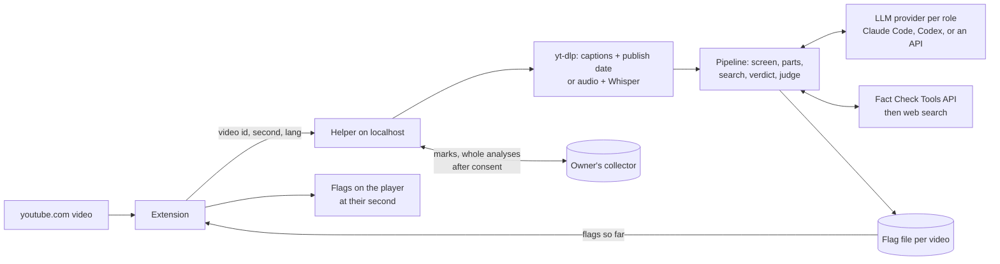
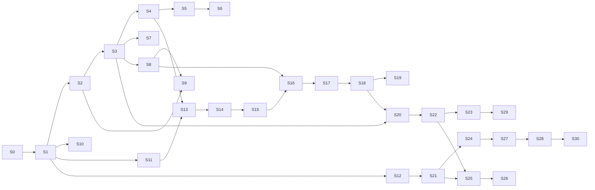

# RFC: Personal fact-checker for recorded YouTube videos

**Status**: Draft · **Date**: 2026-11-15 · **Design**: [ARCHITECTURE.md](ARCHITECTURE.md)
**Toward**: TARGET.md › Step 1

## Summary

A Chrome extension shows flags on top of the YouTube player while a recorded Spanish or English video plays: inaccurate claims, dodged questions, contradictions within the video and with the speaker's record, fallacies, and short context cards. A local Python helper fetches the captions, reads the video with the person's own Claude or ChatGPT subscription (or an API key), judges every flag once more over the whole transcript, and caches the flags per video. Testers install it in one step on macOS or Linux; with their consent, their marks and whole analyses go to the owner's collector, and an analysis the owner approves is served free to the next viewer (S15–S30).

## Problem

- Human fact-checkers in live interviews work under time pressure with little context; the result can be poor (chat).
- A viewer has no second, critical ear while watching: errors and fallacies pass unnoticed.
- Nobody tells the viewer, at the second it is said, whether a claim holds and why.

## Goals and non-goals

| Goals | Non-goals |
|---|---|
| Flags on the YouTube player at the second of the utterance, for recorded videos (chat) | Live streams (TARGET.md Step 3) |
| Flag types: inaccuracy, unanswered question, contradiction (in the video and with the speaker's record), fallacy; plus context cards (chat) | A full archive of every politician's statements; the record is searched per claim |
| Spanish and English: the interface follows the browser language, readings follow the video's language, reasons come in the viewer's language and quotes stay as said (docs/specs/026-spanish-and-english/spec.md) | A third language (one more entry in each table of `core/languages.py`; not planned) |
| Precision first: ≥ 80% on player flags, recall ≥ 50% on the golden dataset (docs/research/interview-youtube-fact-checker.md) | A verdict on the speaker; a flag is a signal |
| No extra cost by default: the person's Claude or ChatGPT subscription; an API key is an option (S20, S22, S23) | A backend that runs the pipeline, accounts, a web player (TARGET.md Step 2) |
| Hard stop: 60 LLM tool calls per started video-hour for parts, verdicts and speakers, plus the judge's calls; the search and the screen each have a budget of the same size (docs/research/interview-youtube-fact-checker.md, S15, S17, S29) | Mobile, the YouTube app, TV, Windows (later) |
| Nothing leaves the machine before the person says yes once; a shared analysis is served only after the owner approves it (docs/specs/030-ready-to-publish/spec.md) | Sharing transcripts, recordings or anything about the machine |

## Proposal

- The helper analyses the video chunk by chunk, in order, faster than playback. The extension polls and shows flags as they arrive.
- A contradiction shows at the second utterance, never before.
- A flag goes on the player when its confidence reaches the bar of its type, measured on the golden dataset per provider (S3, S20); the side panel lists every flag (S11).

**Impact.** Extension, helper, pipeline (screen, parts, fact-check, judge), adapters (YouTube, Whisper, pyannote, five LLM providers, Tavily, Fact Check Tools API, headless Chrome), install and doctor, feedback and shared analyses, the collector (Cloudflare Worker + D1), and the contracts of the flag file, the helper API, `config.toml` and the collector API.

Details, contracts and decisions: [ARCHITECTURE.md](ARCHITECTURE.md).

## Alternatives considered

| Option | Rejected because |
|---|---|
| An API key as the default | A 1.5-hour interview cost 7.40 dollars at API prices (docs/specs/029-cheaper-readings-2/spec.md); the subscription is the default, an API key an option (S22) |
| Web page with an embedded player first | Flags cannot cover the player; no youtube.com experience (chat) |
| Live streams first | Latency pressure, streaming transcription cost, hard to test (chat) |
| Voice diarization from the start | More install and minutes per video; start with LLM attribution and switch only if tests show errors (docs/research/interview-youtube-fact-checker.md) |
| A hosted form or a shared sheet for testers' marks | No hard stops per tester, no owner review of shared analyses (docs/specs/024-shared-feedback/spec.md) |
| Vendor SDKs for the API adapters | The helper has no dependency; plain HTTPS from the standard library (docs/specs/022-provider-config/spec.md) |
| Do nothing (human fact-checkers) | The trigger of the project (chat) |

## Specs

| ID | Name | Delivers | Done when | Depends on |
|---|---|---|---|---|
| S0 | Foundations | Tools installed, Google API key stored, Claude Code logged in, external contracts checked | The person runs yt-dlp, `claude -p` and one Fact Check Tools API query by hand, each with a real result | none |
| S1 | Fallacy flags on the player | Extension + helper + yt-dlp + `claude -p`: fallacy flags with confidence ≥ 80% on the player at their second; analysis starts at the playback second and runs ahead of it; flag file cached per video; hard stop at 60 tool calls per video-hour | The person opens a real Spanish video and sees fallacy flags appear on the player at the right second | S0 |
| S2 | Fact-check flags | Checkable figures and facts found per chunk; Fact Check Tools API first, then web search on official sources, against data at the publish date; all claims of a chunk checked in one Claude tool call | The person sees an inaccuracy flag with its source and date on a real interview | S1 |
| S3 | Quality score | Synthetic golden dataset and an eval command that prints precision and recall per flag type; sets the player threshold from measured precision | The person runs the eval and reads precision and recall for fallacy and inaccuracy flags | S1, S2 |
| S4 | Feedback on cards | A "correct" and an "unfair" button on each card, with an optional reason; the helper keeps the marks in a local log, never in the repo; the eval prints a second table: precision per type and label on the person's marks of real videos | The person marks cards on a real interview and the eval shows the real precision per type next to the golden one | S3 |
| S5 | Speakers, quotes and context | Voices separated from the audio on the laptop and named from the whole interview; each chunk analysed with who says what and a longer context, by a stronger model; quotes, described hoaxes and rhetorical self-questions are not the speaker's claims; each claim keeps the question it answers, the metric it uses and whether it speaks of now or of a plan; a published fact-check counts only when it is about the same event | On the 112-minute interview, the cards the person marked unfair for a wrong speaker, a quote or another event are gone, and the real precision on the person's marks rises | S4 |
| S6 | Disputed figures and source tiers | Verdicts `disputed` (one credible measure supports the claim, another does not), `definition_swap` (the answer uses a wider metric than the one asked, such as homes "mobilised" for homes "delivered") and `plan_as_fact` (a plan told as the present); the measures of what was asked and of what was said; verdict `disputed` when one credible measure supports a claim and another does not, with each measure and its source on the card; "false" only when every credible measure contradicts it; a note when the metric has a documented controversy; source tiers lower the confidence of non-independent sources | The person sees a disputed card for registered unemployment that shows the SEPE figure, the figure with inactive fijos discontinuos, and the EPA; partisan sources no longer support a "false" | S2, S3 |
| S7 | Unanswered questions | Each interviewer question gets a status (answered, partial, dodged) when its answer ends; an answer that gives another figure than the one asked counts as dodged; a dodged question shows the question and a one-line reason; `evasion` leaves the fallacy list | The person sees "question dodged" on a real interview, at the end of the answer | S1, S3 |
| S8 | Contradictions in the video | Speaker attribution by the LLM; contradiction flags at the second utterance; no flag when the speaker is uncertain | The person sees a contradiction flag that quotes both utterances; the eval scores contradictions | S1, S3 |
| S9 | Contradictions with the record | A claim about the speaker's own past words or promises is searched in published fact-checks and on the web; a promise shows when it was made, its figure, its deadline and its status; a contradiction cites the earlier statement with its date and source | The person sees a flag that quotes an earlier public statement, dated and linked | S2, S8 |
| S10 | Context cards | Short neutral cards on people, cases and events the first time they are named | The person sees who a named person is, the first time the name comes up | S1 |
| S11 | Side panel and progress-bar marks | Every flag in a collapsed side panel, those under the player bar too; a mark per flag on a strip under the video | The person opens the panel, clicks a mark and jumps to that flag | S1 |
| S12 | Audio fallback | Audio + local Whisper when a video has no usable captions | The person sees flags on a video with no captions | S1 |
| S13 | Analysis progress and past marks | `analysed_until` in the flag file and the analysed part on the strip; each flag returns the person's latest mark; a marked card shows the mark instead of the buttons | The person sees how far the analysis has reached, and a card they marked shows their mark with a link to change it | S4, S11 |
| S14 | Shareable summary image | One 1080×1350 PNG per video with each speaker's most serious flags marked correct, a timeline and a donut by type, plus its alt text; exported from the side panel | The person exports one image and its alt text from the side panel | S4, S13 |
| S15 | Judge pass | One reading of the whole transcript with speakers rules on every non-context flag before the file says done: keep, "puntualización" (inaccuracies only) or drop, and may move it to another speaker; the found flag stays; the person's mark wins | The person sees nitpicks as grey cards and dropped flags struck through in the panel; on the 1.5-hour interview the judge rules out at least 6 flags marked unfair and touches at most 1 marked correct | S4, S14 |
| S16 | Live recall | Four new fallacy labels (insinuation, double standard, cherry picking, appeal to fear); a positions list of what each speaker stated earlier, fed to each part; a claims log with the outcome of each figure | The live analysis of the 1.5-hour interview catches at least 6 of the 9 high-importance misses, with a judge drop share of at most 47 % | S8, S15 |
| S17 | Cost per video | Tokens and dollar cost of each reading in the usage log and the flag file; only central figures checked, each once per video; a cheaper model searches and Opus gives the verdicts; fixed rules in the cached system prompt | The 1.5-hour interview costs at most 7 dollars and catches as much as in S16 | S16 |
| S18 | Cheaper readings | Five-minute cache and medium effort on every reading; two context modes, `window` and `conversation`; the analysis follows the playback second, up to 10 minutes ahead, and pauses after 60 s with no poll | The comparison on the 1.5-hour interview names the cheaper mode: at most 6 dollars, at least 4 of 9 misses, at most 43 % dropped | S17 |
| S19 | Recall without noise | `conversation` as the default context mode; the judge no longer excuses a contradiction on the speaker's behalf; sharper part, search and verdict prompts | On the 1.5-hour interview: at least 5 of 9 misses caught, at most 32 % dropped, at most 9 dollars | S18 |
| S20 | Codex as a provider | `FACT_CHECK_PROVIDER=codex` routes every reading through `codex exec` on a ChatGPT subscription; tokens logged, no dollar cost; confidence bars per provider | A person with only a ChatGPT subscription sees flags, and the check on the 1.5-hour interview prints Codex's precision on the person's marks beside Claude's | S3, S18 |
| S21 | Beta install | `fact-checker setup` checks the tools and starts the helper at login (launchd, systemd); `doctor`; faster-whisper on Intel Macs and Linux; speakers from the text without a Hugging Face token, with the loss measured; the extension says when the helper is down | A tester on macOS or Linux installs it, and the player says when the helper does not answer | S12 |
| S22 | Provider config | `<helper home>/config.toml` picks the provider and the model of each role; Anthropic Messages API and OpenAI-compatible Responses API on an API key; a price table; doctor names the provider, the models and a missing key | With `provider = "anthropic"` and a key, the person gets the same flags as with Claude Code, each reading priced | S20 |
| S23 | Any API | A `chat` provider for any Chat Completions API (Hugging Face, OpenRouter, Groq, Ollama and others), with a JSON-object fallback; one provider per role through `[roles.<role>]`; Tavily search for a model with no web search | The parts read on an open model through a chat API still give a "false" flag with its source | S22 |
| S24 | Shared feedback | A collector (Cloudflare Worker + D1) that the owner deploys once; marks sent with an anonymous install id; hard stops per tester; the owner pulls new rows with an admin token | A tester's marks reach the collector, and the owner pulls them with `fact-checker feedback pull` | S4, S21 |
| S25 | One-step install | `install.sh` (uv, yt-dlp, ffmpeg from a wheel, the helper; a second run changes nothing); the built extension shipped in the helper package; setup picks the logged-in agent CLI; `key set` with a hidden prompt; `doctor --json`; `INSTALL-AGENT.md` in Spanish and English | A person pastes one sentence into Claude or ChatGPT and the agent installs everything | S21, S22 |
| S26 | Spanish and English | Interface in the browser language with an ES/EN switch; English videos read as English; reasons in the viewer's language, quotes as said; `lang` and `spoken` in the flag file; summary in `lang` | A person with an English browser sees English cards on a Spanish video, and an English video gets flags that quote its English words | S25 |
| S27 | Marks share themselves | Each mark goes to the collector a moment after it is given; with the collector down it waits for the next one; `share_marks` in ⚙ turns sharing off; each card asks "Is this flag fair?" with two large buttons | A tester marks a card and the mark reaches the collector with no button; with sharing off nothing leaves the laptop | S24 |
| S28 | Shared analyses | A whole analysis uploads its stripped flag file; a later viewer in the same language downloads it at once with no reading; the collector keeps the best model's analysis, with hard stops | A second viewer opens an analysed video and sees its flags at once, with "Shared analysis · free" | S27 |
| S29 | Cheaper readings 2 | A cheap screen reading skips parts with nothing to check; Haiku searches by default; `chat` parts read in window mode; doctor lists the screen | The usage log shows small talk skipped by the screen, with no new setting for the person | S23 |
| S30 | Ready to publish | Shared analyses served only after the owner approves them (`fact-checker shared list\|approve\|reject`); a consent box before anything is shared; "signals, not verdicts" and the spend line; no real names or video ids in the repo; `LICENSE`, `PRIVACY.md` | A stranger clones a repo that names no real person, and a new tester is asked once before anything leaves the laptop | S28 |

- **S1 to S7** is the first release: fallacies, fact checks that respect documented controversies, and dodged questions, scored on the golden dataset and on the person's marks of real videos.
- Until S4 has enough marks, the player shows many flags on purpose: the bars measured on the golden dataset are low, so that the person finds the false positives (2026-11-14, chat).
- **S8 and S9** add contradictions; S9 reuses the search of S2.
- **S10 to S12** widen display and reach; S10, S11 and S12 can be built in parallel.
- Voice diarization moved up to S5: the person's marks on a real interview showed 4 of 6 unfair cards came from a wrong speaker (2026-11-14, chat).
- New fallacy labels (blame shifting, fear by association) enter the list only after S3 measures their precision.
- **S13 to S15** make the review loop visible: progress, past marks, a shareable image and a judge over the whole video.
- **S16 to S19** raise recall and cut cost on the 1.5-hour interview. Their code is built; their real-data checks are open (S16 A4, S17 A4, S18 A4, S19 A1–A3).
- **S20 to S23** open the providers: Codex, the Anthropic API, OpenAI-compatible APIs and any chat API, one per role. S20 A3 (Codex on the real interview) is open.
- **S21, S25, S26** open the beta: one-step install on macOS and Linux, in Spanish and English.
- **S24, S27, S28, S30** add the owner's collector: marks and whole analyses, shared only after consent, served only after approval.
- **S29** cuts cost with no new setting.

## S0 checklist

Everything runs on the person's laptop (chat).

| Item | Needed by | Owner |
|---|---|---|
| Python 3.12+, Node.js LTS, yt-dlp installed | S1–S9 | user |
| Claude Code installed and logged in with the subscription | S1–S9 | user |
| Google Cloud project with the Fact Check Tools API enabled; API key stored with `fact-checker key set FACT_CHECK_API_KEY`, never in chat | S2, S9 | user |
| Chrome with developer mode on, to load the unpacked extension | S1 | user |
| Check the contracts of yt-dlp, `claude -p` and the Fact Check Tools API (done 2026-11-13, docs/research/external-contracts.md) | S1, S2 | team |
| Cloudflare account; the collector deployed once with its D1 database and its admin token (done, src/collector/README.md) | S24, S27, S28, S30 | user |
| Optional keys, each with `fact-checker key set`: HF_TOKEN (voices), ANTHROPIC_API_KEY, OPENAI_API_KEY, CHAT_API_KEY, TAVILY_API_KEY | S5, S22, S23 | user |
| Codex CLI logged in with a ChatGPT subscription (for S20 A3) | S20 | user |

## Open questions

**Resolved**

| Question | Answer |
|---|---|
| Who uses Step 1? | The person, and beta testers on their own macOS or Linux machine with their own subscription (2026-11-15, docs/specs/021-beta-install/spec.md, docs/specs/025-one-step-install/spec.md). Was: only the person (2026-11-13) |
| How is a speaker attributed? | Voices come from the audio (pyannote) and the LLM names them from the whole interview; without a Hugging Face token, the LLM infers them from the text, and the loss is measured (2026-11-14, 2026-11-15, docs/specs/005-speakers-quotes-context/spec.md, docs/specs/021-beta-install/spec.md) |
| Which sources count? | Official and primary first; others lower the confidence (2026-11-13, docs/research/interview-youtube-fact-checker.md). An official figure is not the truth by itself: a documented controversy on a metric gives "disputed", not "false"; source tiers by independence (2026-11-14, docs/research/official-data-controversies.md) |
| Against which date is a claim checked? | The publish date of the video; a note shows the updated value (2026-11-13, docs/research/interview-youtube-fact-checker.md) |
| How is quality measured? | Synthetic golden dataset, generated by stronger models, reviewed by the person (2026-11-13, docs/research/interview-youtube-fact-checker.md) |
| Which fallacies are in scope? | A closed list: ad hominem, tu quoque, false dilemma, straw man (same video only), false cause, hasty generalization, vague authority. Evasion moves to unanswered questions in S7 (2026-11-13, 2026-11-14, docs/research/interview-youtube-fact-checker.md). S16 adds insinuation, double standard, cherry picking and appeal to fear (2026-11-14, docs/specs/016-live-recall/spec.md) |
| What does a viewer miss most in a real interview? | Fact checks, dodged questions, contradictions with the speaker's record, context on names; few clear fallacies. S1 on a 112-minute interview found 21 fallacies, none above 0.60 confidence (2026-11-14, chat) |
| Fallacies outside the list, and which speakers? | Outside the list: a review log, never shown. All speakers are analysed, the interviewer included (2026-11-13, docs/research/interview-youtube-fact-checker.md) |
| Can the extension reach the helper from youtube.com? | Yes: content script → message → service worker fetch to `127.0.0.1`; a spike showed no Local Network Access prompt and no CORS need (2026-11-13, docs/research/external-contracts.md) |
| Test doubles with no sandbox? | Cleaned read-only production responses for Claude Code and the Fact Check Tools API; for YouTube, an invented `json3` file, never a real transcript (2026-11-13, docs/research/interview-youtube-fact-checker.md) |
| Google Fact Check Tools API contract? | `GET claims:search` with a header key; ratings are free text; HTTP 400 errors (2026-11-13, docs/research/external-contracts.md) |
| What does yt-dlp give? | Auto captions in `json3` with word timings (`es-orig`), `upload_date`; no speaker (2026-11-13, docs/research/external-contracts.md) |
| Does `claude -p` give JSON and web search headless? | Yes: `--json-schema` fills `structured_output`; WebSearch works headless (2026-11-13, docs/research/external-contracts.md) |
| Where does a source date come from? | The date of a published fact-check when one matches; otherwise the source page is fetched for its date (2026-11-14, chat) |
| Can web search prefer official domains and return dates? | It honours `allowed_domains`; it returns no source date (2026-11-13, docs/research/external-contracts.md) |
| Which languages? | Spanish and English: interface from the browser with an ES/EN switch, readings in the video's language, reasons in the viewer's language (2026-11-15, docs/specs/026-spanish-and-english/spec.md) |
| Which LLM providers? | Claude Code (default), Codex CLI, the Anthropic API, OpenAI-compatible Responses APIs and any Chat Completions API, one per role in `config.toml` (2026-11-15, S20, S22, S23) |
| Do testers' marks reach the owner? | Yes, each mark a moment after it is given, only after the person says yes once (2026-11-15, S27, S30) |
| Can a viewer reuse another person's analysis? | Yes: a whole analysis in the same language, once the owner approves it (2026-11-15, S28, S30) |
| The budget of 60 tool calls per video-hour? | Kept at 60 per started video-hour for parts, verdicts and speakers, plus the judge's calls; the search and the screen each get a budget of the same size (S15, S17, S29; `core/scheduler.py`) |
| Which player threshold? | A bar per flag type: the lowest confidence with precision ≥ 0.80 on the golden dataset, null with fewer than 5 flags; one bars file per provider (S3, S20) |
| Does the collector answer as the helper expects? | Yes: `tests/acceptance/test_contract_collector_marks.py` passed against the deployed Worker (2026-11-15, person) |

**Open**

| # | Question | Blocks | Owner |
|---|---|---|---|
| 11 | Should the helper require a shared token from the extension, since any local program can call `127.0.0.1` and a GET carries no `Origin`? (docs/research/external-contracts.md) | none | user |
| 8 | Subscription usage limits of `claude -p` per hour, and the error when a limit is hit (docs/research/external-contracts.md) | none | team |
| 9 | Fact Check Tools API quotas (docs/research/external-contracts.md) | none | team |
| 14 | Should blame shifting join the fallacy list? S16 added appeal to fear; fear by association is not in the list. Only if S3 measures enough precision (chat) | none | user |

**Decision (2026-11-13):** Step 1 runs on the person's Claude subscription with no extra cost. Revisit if the subscription limits stop a one-hour video, or when a second user needs it (chat).

**Decision (2026-11-15):** Testers run Step 1 on their own subscription (Claude or ChatGPT) or their own API key; the owner pays only the collector, on the Cloudflare free plan. Revisit when a tester cannot afford a video, or when the collector leaves the free plan (S20–S30).
