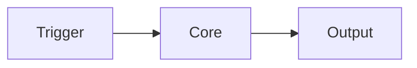
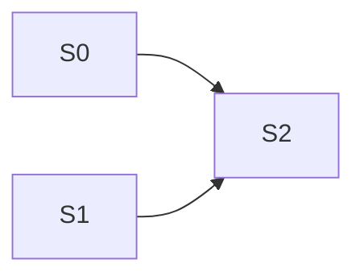

# RFC: <title>

**Status**: Draft · **Date**: <YYYY-MM-DD> · **Design**: [ARCHITECTURE.md](ARCHITECTURE.md)
**Toward**: TARGET.md › Step <n> <or delete this line if docs/TARGET.md does not exist>

## Summary

<Two or three sentences: what we build, how it works, what ships first, how it grows.>

## Problem

- <Pain 1, concrete>
- <Pain 2: cost, risk or time lost>
- <Question that today has no single answer>

## Goals and non-goals

| Goals | Non-goals |
|---|---|
| <Outcome we commit to> | <Related thing we will not do> |
| <Outcome> | <Deferred to v2> |
| <Safe-by-default property> | <Thing we will not build> |

## Proposal

**Impact.** <Modules and contracts that this work touches, in one line.>

Details, contracts and decisions: [ARCHITECTURE.md](ARCHITECTURE.md).

## Alternatives considered

| Option | Rejected because |
|---|---|
| <Option A> | <Reason> |
| <Option B> | <Reason> |
| <Do nothing> | <Reason> |

## Specs

Each row becomes one mini-spec in `specs/` (`/mini-spec`). Each row after S0 adds something that a user can use. Order the rows by value and risk.

| ID | Name | Delivers | Done when | Depends on |
|---|---|---|---|---|
| S0 | Foundations | <Resources, access and credentials created by hand. A checklist, not code> | <Result that a person can see> | none |
| S1 | <Smallest usable version> | <The smallest thing a user can use from end to end, such as one command that turns one real input into one real output. If there is an external system, it reaches the real one (sandbox) and fetches one real item; if not, a fake proves it> | <What a user can do now> | <none, or S0 if it reaches an external system> |
| S2 | <What a user can do next> | <One more thing a user can do, such as a filter or sign-in. Never a layer such as "parser" or "render"> | <What a user can do now> | S0, S1 |

- **S1 to S<n>** is the first release: <what it already delivers>.
- **S<n+1>** only adds <speed, scale or reach>; the core does not change.
- <Which specs can be built in parallel.>

## S0 checklist

<Where it is created and why. Request every permission at once: approvals are the slowest part.>

| Item | Needed by | Owner |
|---|---|---|
| <Resource or permission> | S1–S<n> | team |
| <Approval from another team> | S<n> | <approver> |
| <Credential, stored from your own terminal, never in chat> | S<n> | user |

## Open questions

**Resolved**

| Question | Answer |
|---|---|
| <Question> | <Answer, with date and source link> |

**Open**

| # | Question | Blocks | Owner |
|---|---|---|---|
| 1 | <Question> | S<n> | <owner> |

**Decision (<YYYY-MM-DD>):** <What was decided and the condition to revisit it.>
