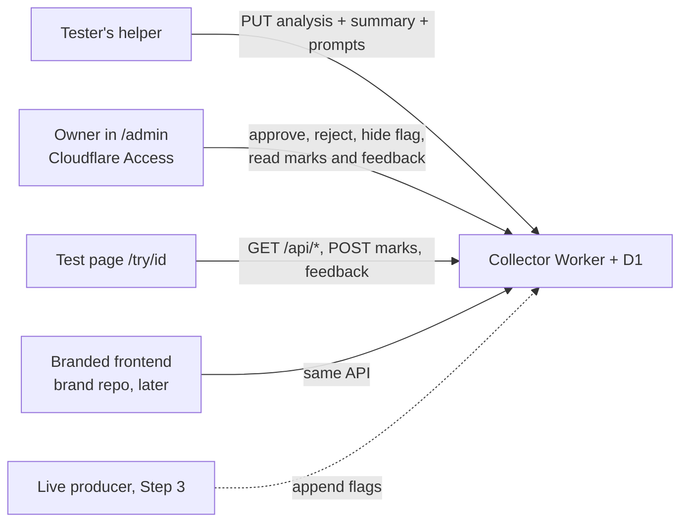
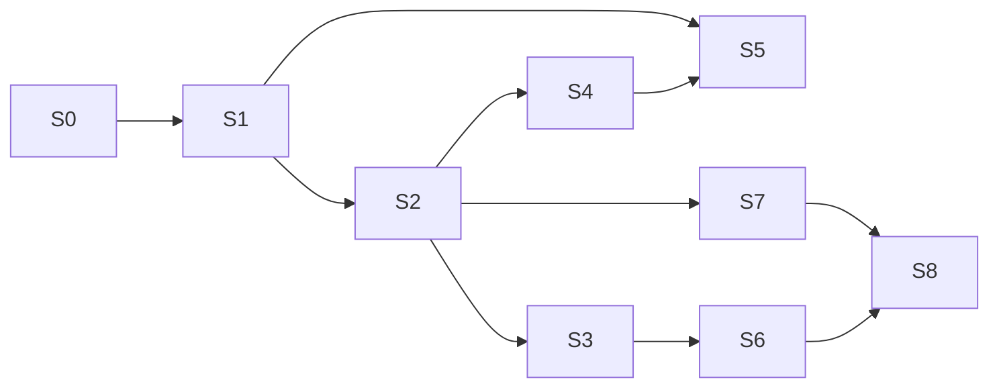

# RFC: Public web of approved analyses, backend first

**Status**: Done · **Date**: 2026-11-20 · **Design**: [ARCHITECTURE.md](../../ARCHITECTURE.md)
**Toward**: TARGET.md › Step 2
**Follows**: [001](../001-personal-fact-checker-for-recorded-youtube-videos/RFC.md) · the web serves the shared analyses that 001 built

## Summary

The collector Worker gains the backend of a public web: an owner review page, a public read API of approved videos with a cursor on flags, a blank test page, web marks, the prompts of each analysis and feedback on them. The branded frontend is its own RFC in the brand repo, which starts once this RFC closes (docs/research/interview-remaining-backend.md). The API is shaped for live streams from the start, so Step 3 changes the producer, not the web (chat).

## Problem

- Today a viewer needs macOS or Linux, a subscription, the helper and the extension, so almost nobody sees a flag (chat).
- The owner reviews uploads only in a CLI that shows the parts model and the flag count. The other models, the cost and the type of video are not shown (chat, `src/collector/README.md`).
- The owner cannot drop one bad flag of a good analysis before it goes public. Example: an insinuation flag on a question about a rival's party primaries, in debate B of 2026-11-19 (chat, docs/BACKLOG.md item 17).
- People cannot see how a flag was made, or say which rule they think is wrong (chat).
- The public numbers would be wrong today: "correct" counts unverifiable claims, and an insinuation runs no search for a public basis (docs/BACKLOG.md items 15, 17).

## Goals and non-goals

| Goals | Non-goals |
|---|---|
| An owner review page `/admin` behind Cloudflare Access. For each pending upload it shows the models per role, cost, type (interview or debate), flags and serious flags. The owner approves or rejects the upload and hides single flags (chat) | Notifications of new uploads (chat) |
| A public JSON API under `/api/`, with its contract in ARCHITECTURE and example responses of an invented debate and interview, so the frontend is designed from it once this RFC closes (chat, docs/research/interview-remaining-backend.md) | The branded frontend: its own RFC in the brand repo, which consumes this API (chat) |
| One flags call for recorded and live videos: `GET /api/videos/<id>/flags?after=<cursor>` (chat) | Live analysis itself (TARGET.md Step 3) |
| A blank, unlisted test page with the embed and the extension's panel, to try the backend in a browser (chat) | Design, fullscreen modes, share preview and home page: frontend RFC (chat) |
| Web marks: anonymous id, consent once, a global daily hard stop (chat, docs/research/interview-public-web-page-for-approved-analyses.md) | Accounts or sign-in for viewers |
| Feedback on the method: (A) a flag marked unfair names its rule; (B) comments anchored to a prompt component or a selected text span. Anyone may comment; comments are private in the beta (chat) | Feedback applied to a prompt automatically. The owner turns it into a golden case first (chat) |
| The owner hides a flag with no Python run: the Worker sums the counts that the helper tags on each flag (docs/research/interview-remaining-backend.md) | A backend that analyses any video on demand (TARGET.md Step 2, later). "Correct" counts only true verdicts, and an insinuation is checked for a public basis (S9, S10): the next RFC, with a new real analysis of debate B; they still gate going public (docs/research/interview-remaining-backend.md) |

## Proposal

- **Review.** `/admin` shows what `GET /analyses` keeps today, plus the upload's `readers` (model per role), `cost_usd`, the type of video (two or more guests is a debate), and the number of serious flags (chat, `src/helper/fact_checker/analyses.py` SHARED).
- **Hide.** A flag that the owner hides is never served, and counts in no summary (chat).
- **Cursor.** Each flags response returns its flags and a cursor. A recorded video answers everything at once with an end cursor. A live video answers what is new since the cursor (chat).
- **Test page.** `/try/<video_id>` holds the YouTube embed and the extension's panel (`src/extension/src/panel.ts` `mountPanel`), fed by the API through a small adapter from the IFrame player to the video interface that the panel reads (chat).
- **Summary.** The guest summary is computed by the helper's Python `card()`, never copied into TypeScript (chat).
- **Prompts.** The helper exports its prompts as JSON, with stable ids per component and rule, for each helper version. A served analysis names its version, so the web shows the prompts that made it. The explore page already shows them, copied from the code at one commit; the export makes that copy part of the helper (chat, docs/index.html Prompts tab).
- **Feedback.** One row per item: kind `flag` (flag id and rule id) or `prompt` (version, component, quoted span). It holds a text and the anonymous id. A daily hard stop applies. Only the owner reads it in `/admin` (chat).
- **Live rule (Step 3, decided now).** The owner starts the analysis of a live stream. Its flags show as "live, not reviewed": high confidence only, never "serious". The owner reviews the stream afterwards like a recorded video (chat).
- **Before public.** Move to Workers Paid, and cache approved responses: the free plan stops at 100,000 Worker requests a day and 10 ms CPU per request (chat, [Workers limits](https://developers.cloudflare.com/workers/platform/limits/)).

**Impact.** Collector Worker (`/admin`, `/api/*`, `/try/`, feedback routes, hide), collector schema (hidden flags, summaries, prompts, feedback, web marks), `analyses.py` upload contract (summary, prompts), the extension's panel built a second time for the test page, core `factcheck.py`, `summary.py`, `pipeline.py` and `judge.py` (BACKLOG 15, 17).

Details, contracts and decisions: [ARCHITECTURE.md](../../ARCHITECTURE.md).

## Alternatives considered

| Option | Rejected because |
|---|---|
| Frontend first, as in the previous draft | The brand is built in another repo; the backend can be built and tested now (chat) |
| The frontend in this RFC | It is design work with its own pace; only the API contract is shared (chat) |
| One whole JSON per video, no cursor | Live streams would need a second contract and a second frontend path (chat) |
| Summary computed in the Worker (TypeScript) | Two implementations of the card logic would drift (chat) |
| Notifications of new uploads (email, Telegram) | Noise; the `/admin` page is enough (chat) |
| Public comments in the beta | They would need moderation (chat) |
| Feedback applied to prompts automatically | Prompt injection and biasing the verifier (chat) |
| Live: a delay so the owner reviews each flag | The owner would have to watch every stream (chat) |
| Live: published only after it ends | Loses the point of live (chat) |
| Do nothing | Reach stays with people who install the helper (chat) |

## Specs

Each row becomes one mini-spec in `specs/` (`/mini-spec`). Each row after S0 adds something that a user can use.

| ID | Name | Delivers | Done when | Depends on |
|---|---|---|---|---|
| S0 | Foundations | Cloudflare Access on `/admin`; `docs/research/youtube-embed.md` part 1 (IFrame Player API); the Access and Workers static assets contracts read | The owner opens `/admin` and gets an Access login; the research file states how the page reads the time of an embed and seeks it | none |
| S1 | Review uploads on the web | `/admin`: pending uploads with models per role, cost, type, flags and serious flags; open one to read its flags; approve or reject | The owner approves a real pending upload in `/admin`, and another machine's helper then downloads it | S0 |
| S2 | Read approved videos through the API | `GET /api/videos`, `GET /api/videos/<id>?lang=` (another language, with a note), `GET /api/videos/<id>/flags?after=`; cached; example responses of an invented debate and interview in `docs/api-examples/`, built from the shapes of real answers | `curl` lists a real approved video and its flags, the returned cursor gives nothing new, and the examples match what the API returns | S1 |
| S3 | Try one video on a test page | `/try/<video_id>`: a blank page, unlisted and `noindex`, with the YouTube embed and the extension's panel fed by the API; flags light at their second, a click seeks | The owner opens `/try/<id>` of a real approved video on a laptop and a phone, and sees its flags light up as it plays | S2 |
| S4 | Guest summary in the API | The helper's summary per guest travels with the upload; the API serves it | The API shows, for a real approved debate, the numbers of the helper's profile cards | S2 |
| S5 | Hide a flag | `/admin` hides a single flag; it leaves the API, the helper download and every summary count | A hidden flag of a real video is gone from the API, from `/try/` and from its guest's counts | S1, S4 |
| S6 | Marks from the web | Marks from the test page: anonymous id, consent once, a global stop of about 2,000 a day; marks in `/admin` and `feedback pull` | A mark given on `/try/` shows in `/admin` and in `feedback pull` | S3 |
| S7 | Prompts of each analysis | The helper exports its prompts as JSON with stable ids per component and rule; the upload names the version; `GET /api/prompts/<version>` | The API returns the prompts of the version that made a real approved video, with the rule id of each of its flags | S2 |
| S8 | Feedback on the method | `POST /api/feedback`: (A) unfair flag plus rule, (B) comment on a component or a quoted span of a version; private, daily stop; read in `/admin` | A comment on a selected span of the insinuation rule, sent from `/try/`, shows in `/admin` with its anchor | S6, S7 |

- **S1 to S8** is the whole RFC: the backend and a test page to try it. S9 and S10 (correct means true, insinuation checks a public basis) moved to the next RFC (docs/research/interview-remaining-backend.md).
- The frontend RFC in the brand repo starts once this RFC closes (docs/research/interview-remaining-backend.md).
- What remains is built in the order S4 → S5 (docs/research/interview-remaining-backend.md).

## S0 checklist

The Worker and D1 already run on the owner's Cloudflare account. Everything new goes there.

| Item | Needed by | Owner |
|---|---|---|
| Cloudflare login that deploys `fact-checker-feedback` | S1–S8 | user |
| Cloudflare Access application on `/admin`, with the owner's email as the only allowed identity | S1 | user |
| `docs/research/youtube-embed.md`, part 1: IFrame Player API (current time, duration, seek, a video that cannot be embedded). The policy on overlays stays with the frontend RFC | S3 | team |
| The Workers static assets and Cloudflare Access contracts read into research | S1, S3 | team |
| Workers Paid plan (5 $/month) | before the first public link | user |

## Open questions

**Resolved**

| Question | Answer |
|---|---|
| Precision or recall first in the beta? | Recall first; the owner's approval is the precision filter of the public web (2026-11-16, chat) |
| When does precision come first again? | When the verifier RFCs are done (2026-11-17, docs/research/interview-public-web-page-for-approved-analyses.md) |
| Does recall first lower the extension's bars? | No, it changes only the web (2026-11-17, docs/research/interview-public-web-page-for-approved-analyses.md) |
| An analysis exists only in the other language? | Show it, with a note that names the language (2026-11-16, docs/research/interview-public-web-page-for-approved-analyses.md) |
| Anonymous web ids can rotate past the per-id stop? | Yes, with a global daily stop of about 2,000 web marks (2026-11-16, docs/research/interview-public-web-page-for-approved-analyses.md) |
| Share preview of a debate? | The YouTube thumbnail; one guest's card only with a single guest (2026-11-17, docs/research/interview-public-web-page-for-approved-analyses.md). Built by the frontend RFC |
| Who approves uploads? | The owner, in `/admin`, with no notifications (2026-11-20, chat) |
| Can the owner drop single flags? | Yes, hide them before or after approval (2026-11-20, chat) |
| Feedback on prompts? | A and B; B as comments on a component or a selected span (2026-11-20, chat) |
| Who comments, who sees? | Anyone; private in the beta (2026-11-20, chat) |
| Live publishing rule? | The owner starts it; live flags unreviewed, high confidence only, never serious; reviewed afterwards (2026-11-20, chat) |
| Flags over the player in fullscreen? | Try both a cinema mode and an overlay, then pick; in the frontend RFC (2026-11-20, chat) |
| Backend or frontend first? | Backend here; the frontend is its own RFC in the brand repo, started once this RFC closes (2026-11-21, docs/research/interview-remaining-backend.md) |
| A page to try it before the design? | Yes: a blank test page with the embed and the extension's panel (2026-11-20, chat) |
| Cloudflare Access contract? | A JWT in `Cf-Access-Jwt-Assertion`, verified by the Worker with `jose` against the team's keys, issuer and AUD tag; never `ctx.access`. A path-based application covers `/admin` and `/admin/*` of the `workers.dev` host (2026-11-20, docs/research/cloudflare-access-and-assets.md, dashboard) |
| YouTube IFrame Player API? | `getCurrentTime()` polled, `getDuration()`, `seekTo(s, true)`; errors 101 and 150 when embedding is not allowed (2026-11-20, docs/research/youtube-embed.md) |
| Workers static assets? | `[assets]` beside the Worker; `run_worker_first` on the API and owner routes so a file never shadows a route (2026-11-20, docs/research/cloudflare-access-and-assets.md) |
| CORS on the public `/api/` routes? | Any origin: read-only public data with no credentials (2026-11-20, chat) |
| Where is the guest summary computed once hiding happens in `/admin`, where no Python runs? | The uploader's helper computes it and tags each flag with the counts it adds to; the Worker sums the flags that are not hidden (2026-11-21, docs/research/interview-remaining-backend.md) |
| How does a hidden flag's claim count? | As an `unfair` mark: the flag counts nowhere, the claim stays checked and counts as correct (2026-11-21, docs/research/interview-remaining-backend.md) |
| Do S9 and S10 stay in this RFC? | No: they move to the next RFC with a new real analysis of debate B; they still gate going public (2026-11-21, docs/research/interview-remaining-backend.md) |
| Which video proves S7 and S8 for real? | A recent local analysis uploaded again with the current prompts, which differ by one line of the speakers prompt that changes no flag (2026-11-21, docs/research/interview-remaining-backend.md) |

**Open**

| # | Question | Blocks | Owner |
|---|---|---|---|
| 6 | The confidence that counts as "high" for live flags | Step 3 | user |

**Decision (2026-11-20):** Step 2 builds the backend of the public web first, in the existing collector Worker, with a flags API that live streams will reuse and a blank test page to try it. The frontend is its own RFC in the brand repo, started once this RFC closes. Nothing goes public before S9 and S10 (next RFC) and the Workers Paid plan (chat, docs/research/interview-remaining-backend.md).
