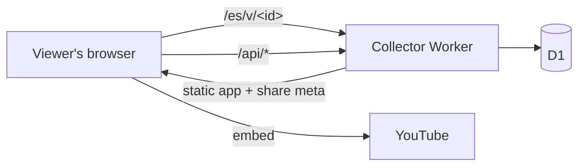
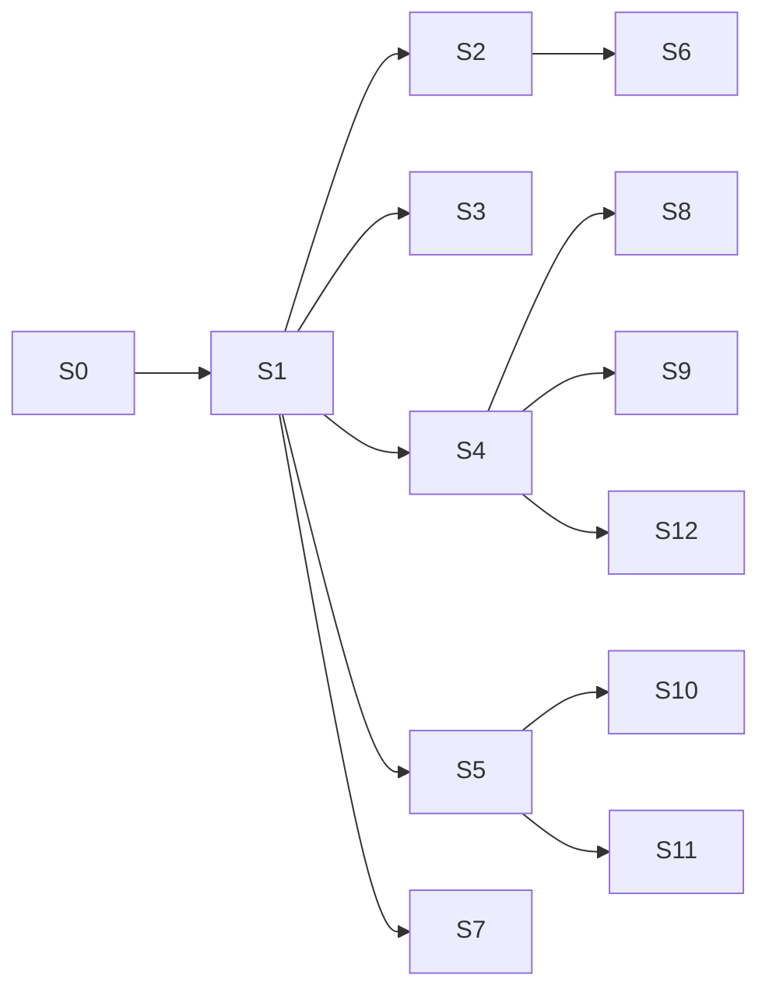

# RFC: Public web of approved analyses, frontend

**Status**: Done · **Date**: 2026-11-21 · **Design**: [ARCHITECTURE.md](../../ARCHITECTURE.md)
**Toward**: TARGET.md › Step 2
**Follows**: [002](../002-public-web-of-approved-analyses-backend-first/RFC.md) · the web reads the API, review page and test page that 002 built

## Summary

A bilingual web, in the CALVET brand, lets anyone watch an approved video with its flags lit at their second, browse the approved videos, read each guest's profile card and a comparison, and learn how the analysis works. It is a React app built to static files that the collector Worker serves next to the API, so one deploy ships both. The viewer ships first and replaces the test page; each screen is designed in Claude Design before it is built (docs/archive/003-public-web-of-approved-analyses-frontend/research/interview-public-web-frontend.md).

## Problem

- The only way to see an approved analysis on the web is `/try/`, a blank page that reuses the extension's panel and does not look like CALVET (chat).
- The API already serves the profile card numbers of each guest and the prompts of each version, but no page shows them (docs/archive/002-public-web-of-approved-analyses-backend-first/RFC.md).
- Nothing tells the owner which videos people open (chat).

## Goals and non-goals

| Goals | Non-goals |
|---|---|
| A viewer: the YouTube embed, a timeline with a verdict mark per flag, the flag panel, seek on click, Spanish and English (chat) | Going public: it waits for S9 and S10 of the next quality RFC, the Workers Paid plan and a custom domain (chat) |
| The CALVET brand from the brand repo: tokens, fonts, wordmark and six verdict marks; the screens are designed here (docs/archive/003-public-web-of-approved-analyses-frontend/research/calvet-brand.md, chat) | Following the brand repo's screen brief (chat) |
| A video list, a guest's profile, a comparison, a "how it works" page (chat) | Viewer accounts or sign-in (docs/archive/002-public-web-of-approved-analyses-backend-first/RFC.md) |
| Web marks and method feedback through the existing contracts, with no API change (docs/archive/003-public-web-of-approved-analyses-frontend/research/interview-public-web-frontend.md) | Changing the extension's panel (docs/archive/003-public-web-of-approved-analyses-frontend/research/interview-public-web-frontend.md) |
| A share preview per video: the YouTube thumbnail and its title (docs/archive/002-public-web-of-approved-analyses-backend-first/research/interview-public-web-page-for-approved-analyses.md) | Server rendering |
| Visit counters per video and language, with no cookie and no per-person id (chat) | Third-party analytics |

## Proposal

- A React app under `src/web/` builds to the collector's static assets. The Worker serves its HTML for `/`, `/es/*` and `/en/*`. For a video address it writes the title and thumbnail into the page's share meta, by replacing escaped placeholders, and it counts the visit.
- The pure logic of the panel (the flag lit at a second, the order) moves to a module that the extension and the web share. The web's panel is React; the extension does not change.
- Each flag gets one of the CALVET marks: Falso, Engañoso, Retórica, Evasiva, Contexto; Correcto appears only in the summary counts.
- Each screen is first designed in Claude Design with real API data. The owner approves it, then it is built with its tests.

**Impact.** New `src/web/` (React app) and a shared panel-logic module; collector Worker (app routes, share meta, visit counters, `/try/` redirect); D1 schema (visits); `wrangler.toml` assets and `run_worker_first`; the review page (visits).

Details, contracts and decisions: [ARCHITECTURE.md](../../ARCHITECTURE.md).

## Alternatives considered

| Option | Rejected because |
|---|---|
| The frontend in the brand repo | Two deploys and CORS; the viewer's player logic and its tests live here (chat) |
| Next or Astro with server rendering | More pieces than a static app and one Worker that writes the share meta (docs/archive/003-public-web-of-approved-analyses-frontend/research/interview-public-web-frontend.md) |
| Plain TypeScript, like `/try/` | Does not scale to five screens in two languages (docs/archive/003-public-web-of-approved-analyses-frontend/research/interview-public-web-frontend.md) |
| Keep `/try/` beside the viewer | Two players to keep (docs/archive/003-public-web-of-approved-analyses-frontend/research/interview-public-web-frontend.md) |

## Specs

Each row becomes one mini-spec in `specs/` (`/mini-spec`). Each row after S0 adds something that a user can use. Order the rows by value and risk.

| ID | Name | Delivers | Done when | Depends on |
|---|---|---|---|---|
| S0 | Foundations | The brand files in the repo (tokens with Evasiva, the three fonts, the wordmark SVGs) and their font licences checked; `docs/archive/003-public-web-of-approved-analyses-frontend/research/workers-spa-and-rewriter.md`: how static assets serve one HTML for many paths and how `HTMLRewriter` sets meta tags | The tokens, fonts and wordmark are in the repo, and the research file states both contracts with their sources | none |
| S1 | Watch a video with its flags | `/es/v/<id>` and `/en/v/<id>`: the embed, the timeline with verdict marks, the panel, the lit flag, seek on click, a note when only the other language exists, phone layout, share meta | The owner opens a real approved debate on a laptop and a phone in both languages, flags light and seek, and a shared link shows the thumbnail and title | S0 |
| S2 | Mark and comment from the viewer | Consent once, marks (correct, unfair), unfair plus rule, a comment anchored to the flag's quote, through the existing routes | A mark and a comment given on the viewer show in `/admin` | S1 |
| S3 | Full screen on a phone | Landscape full screen on a phone with the overlay of S1 | The owner turns a phone sideways in full screen and sees the cards and the panel sheet over the video | S1 |
| S4 | Pick a video | The list, at `/es/`, `/en/` and `/` until S12 moves it to `/<lang>/videos`: the approved videos, newest first, each linking to its viewer, with the newest as a lead; per video its avisos by verdict, avisos per 10 minutes with a level meter, and a verdict mix bar; seven sort orders kept in the URL; loading and empty states; the viewer's note when only the other language exists (design: canvas page `s4-elegir`) | The owner opens `/es/`, sees every approved video with its avisos per 10 minutes, sorts by "Más discutidos primero" and opens one | S1 |
| S5 | A guest's profile | The helper uploads each person's speaking time, turns and longest turn; the API serves them with the person's role. `/<lang>/v/<id>/<guest>`: avisos per 10 minutes of the guest's own speech with a provisional level, avisos by kind to explore with links to their moment, the states with no summary, no speaking time and a host with no card, and the links from the viewer (design: canvas page `s5-perfil`) | The owner opens a real debate guest's profile, sees their speaking time and avisos, and jumps to one in the video | S1 |
| S6 | How it works | The pipeline, the marks with an example each, confidence, sources, the prompts of a version, a general comment | The owner reads the page in both languages and sends a comment that shows in `/admin` | S2 |
| S8 | Filter and search the list | One toolbar: a free-text search, channel and guest menus (the guest one with a search), "También en inglés", the sort and the view; no filter by kind of aviso (owner); every choice in the URL, one count rule, the no-results state and the phone's "Filtros" sheet | The owner filters by a guest and a channel, reloads with the same list, and "Quitar filtros" brings back every video | S4 |
| S9 | Grid view and what you watched | The grid view, Nuevo, Visto and Empezado, the watched bar under a thumbnail, and thumbnails dimmed at rest, kept in browser storage only; a phone keeps the rows | The owner switches to the grid, and a video they started shows its progress there | S4 |
| S10 | Compare the guests | `/es/v/<id>/comparar`, `/en/v/<id>/compare`: a mirrored balance for 2 guests and columns on one scale for 3 or 4, each against the debate and never against another person; who speaks when, from the list of voice turns | The owner opens the comparison of a real debate and sees both guests on one scale | S5 |
| S11 | Download a guest's card | The "Descargar ficha" sheet: 1:1, the owner's InterviewCard in 4:5, A4 and Letter, ES or EN, alt text, the disclosure line locked on every card; the guest's image from the video's thumbnail, with the owner's face swap in `/admin` | The owner downloads a guest's 4:5 card, and each debate guest shows their own face | S5 |
| S12 | The home page | `/es/` and `/en/` become the home page and the list moves to `/es/videos` and `/en/videos`; `/` still sends by language. The headline, one lede, a figures line (videos · hours · guests), a reduced "Lo último", "Datos revisados" (3 cards from the 5 newest videos' flags), "Los más discutidos" and "Cómo se hace" as the route of 7 steps and the open loop; no API change; laptop and phone (design: canvas pages `portada` and HomePhone, chat) | The owner opens `/es/` on a laptop, sees the newest checked claims, and reaches the list from "Ver todos los vídeos" | S4 |
| S7 | Visits and the end of `/try/` | Visits and "go to the moment" clicks per day in `/admin`; `/try/<id>` redirects to the viewer and its page goes | `/admin` shows the visits of a real video, and an old `/try/` link opens the viewer | S1 |

- **S0 to S11** is the whole web, built but not announced: pages stay `noindex` until going public.
- S2, S3, S4, S5 and S7 can run in parallel after S1; S8 and S9 after S4; S10 and S11 after S5.

## S0 checklist

| Item | Needed by | Owner | Status |
|---|---|---|---|
| Brand files copied from the brand repo (tokens.css with Evasiva, wordmark SVGs) | S1–S6 | team | done |
| Newsreader and JetBrains Mono font files and their licences | S1–S6 | team | done |
| Workers static assets for many paths and `HTMLRewriter`: contract read from Cloudflare docs | S1 | team | done |

## Open questions

**Resolved**

| Question | Answer |
|---|---|
| Where is the frontend built? | Here; the brand repo gives the brand only (2026-11-21, docs/archive/003-public-web-of-approved-analyses-frontend/research/interview-public-web-frontend.md) |
| Which technology? | React with Vite and TypeScript, static, served by the collector Worker (2026-11-21, docs/archive/003-public-web-of-approved-analyses-frontend/research/interview-public-web-frontend.md) |
| Languages? | Spanish and English (2026-11-21, docs/archive/003-public-web-of-approved-analyses-frontend/research/interview-public-web-frontend.md) |
| Verdict marks? | Falso, Engañoso, Retórica, Evasiva, Contexto; a judge's nitpick reads Puntualización with the context mark; Correcto in counts only (2026-11-21, docs/archive/003-public-web-of-approved-analyses-frontend/research/calvet-brand.md, chat) |
| Addresses? | `/<lang>/`, `/<lang>/v/<id>`, `/<lang>/v/<id>/<guest>`, the comparison, how it works (2026-11-21, docs/archive/003-public-web-of-approved-analyses-frontend/research/interview-public-web-frontend.md) |
| Flags over the player in full screen? | Overlay: the viewer's own full screen holds the video, the bar, the cards and the panel as a side sheet; built in S1 (2026-11-21, chat) |
| Visits? | Aggregate counters per day, no cookie (2026-11-21, docs/archive/003-public-web-of-approved-analyses-frontend/research/interview-public-web-frontend.md) |
| Workers static assets and `HTMLRewriter`? | The Worker runs first on `/`, `/es/*`, `/en/*`, reads `/app/` through `ASSETS` and sets the share meta by replacing escaped placeholders in it; `HTMLRewriter` was dropped because no Node test can run it (2026-11-21, docs/archive/003-public-web-of-approved-analyses-frontend/research/workers-spa-and-rewriter.md, chat) |
| The viewer's design? | Approved in Claude Design after a review panel: disputed claims are Engañoso with a sub-label, context notes counted apart with a speaker filter, low confidence dimmed, an AI disclosure under the title; after the owner's review a flag also shows over the video with the panel open, under a setting (2026-11-21, docs/archive/003-public-web-of-approved-analyses-frontend/research/interview-public-web-frontend.md, chat) |
| The guest's cover? | The video's thumbnail, the guest's half in a debate of two, with an owner swap per video in `/admin` (2026-11-22, chat) |
| The home page on a phone? | Designed (board HomePhone) and built (2026-11-22, chat) |

**Open**

| # | Question | Blocks | Owner |
|---|---|---|---|
| 1 | The custom domain of the public web | going public | user |
| 2 | The topic and the question of each flag (a new field of the model's output, more cost per video): wanted on the guest's profile, parked (chat) | none | user |
| 4 | Does the list keep its own "Lo último" lead once the home page has one? Kept until answered (chat) | S12 | user |
| 6 | A frame of each guest from their longest turn, in place of the thumbnail half (the thumbnail's order needs the owner's swap, and its text reads mirrored) (chat) | none | user |
| 7 | The share image of a profile link (`og:image`): needs image storage; until then the video's thumbnail (chat) | none | user |
| 8 | On the card, "Destacados" and "Peso: altos · medios · bajos", or the old "Lo más grave" and "Gravedad"? Asked by design (chat) | none | user |

**Decision (2026-11-21):** The frontend is built in this repo, in React, served by the collector Worker; the brand repo gives only the brand. Nothing goes public before S9 and S10 (next quality RFC), the Workers Paid plan and a custom domain (chat).
