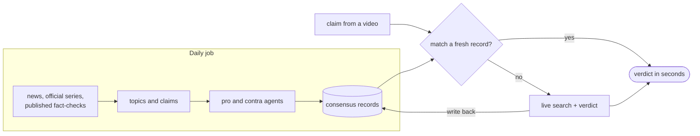

# A shared claim knowledge base ("brain") for the verifier (2026-11-20)

Sources: the flag files, usage log and `claims.jsonl` of three real runs in the helper home (interview A of 2026-11-13; debate B of 2026-11-19 in two broadcasts, radio and newspaper, the latter read up to 1:36:30); the independent re-check of 30 claims of the radio broadcast (BACKLOG item 15); `docs/research/abc-quality-2026-11-15.md`. No external source.

## The idea

A daily job gathers news, official data and published fact-checks. Agents with opposite briefs argue each topic until they reach a consensus record. The verifier matches each claim of a video against these records and answers in seconds; only a claim with no record goes to a live search.

## What our data says

| Question | Measure | Value |
|---|---|---|
| Where does the cost go? | Debate B (radio broadcast), 36.29 $ | search 69 %, parts 16 %, verdict 13 %, judge 2 % |
| Where does the latency go? | Mean time per 2-min part | read 17 s, search 41 s, verdict 33 s |
| Do claims repeat across events? | Flagged claims of the 11-13 interview found again in the 11-19 debate | 2–3 of 25 (a migration figure, a tax take figure) |
| Does the same claim get the same verdict? | The same debate, two broadcasts, flagged claims in common | 20 of 58 |
| Is "correct" reliable? | 30 claims ruled correct, checked again | 23 true or mostly true, 5 unverifiable, 2 misleading |

## What it solves, and what it does not

| Goal | Effect | Why |
|---|---|---|
| Cost | Partial | It removes the search of a matched claim, the 69 % share. Detection (parts) still reads every video. The daily job has a cost of its own, paid even on days with no video |
| Latency | Partial | A hit skips search and verdict (about 74 s of 91 s per part). A new claim is as slow as today |
| Consistency | Strong | One record gives one verdict to the same claim in every video. Today two runs share about half of their flags |
| Bias | Weak to medium | Opposite briefs surface counter-evidence. But agents built on the same model share blind spots: a consensus of LLMs is not a source. The record must cite sources, not votes |
| Recall of new claims | None | A debate brings claims nobody published yet; the live path stays |

## Risks

- **Claim matching is the hard part.** "21 % margin" and "21 % less migration" share a figure and nothing else; "220,000 M more in 2026" may differ from the same figure in 2025. A wrong match gives a confident wrong verdict in seconds: worse than a slow right one. Match on subject, metric, period and figure, never on wording alone.
- **Staleness.** A record carries the date of its data and an expiry; a figure that the source revised after the record must not be served.
- **Unbounded job.** The daily job needs a hard stop on topics, agents and searches, like the per-video budget.
- **Consensus as authority.** A record is a summary of sources, with tiers, as `measures` already are. A topic with no consensus stays "disputed", not forced.

## Fit with the architecture

- It is a new component and a server, so it belongs to Step 2 of `TARGET.md` (analysis on a server, once per video), through `/rfc`.
- The seam exists: the pipeline already asks a fact-check port (Google Fact Check Tools) before its own search. A knowledge base is one more adapter behind that port.
- Prerequisite shared with BACKLOG items 5 and 15: keep the verdict, figure and sources of every checked claim, not only the flagged ones. Without that, no record can be written back.

## Recommended path

| Step | What | Measure that decides the next step |
|---|---|---|
| 1 | Keep every claim's verdict (BACKLOG 5, 15) | none: needed anyway |
| 2 | Cache of our own verdicts across videos, with a strict match and an expiry | Hit rate over the campaign videos; a wrong match rate under 2 % on a hand-checked sample |
| 3 | Daily ingest of published fact-checks (ClaimReview) and official series of the topics that step 2 hits most | Hit rate gain over step 2 per dollar of the job |
| 4 | Pro and contra agents only for the topics marked disputed | Agreement with the owner's marks against step 3 |

Step 2 alone takes the repeats (party talking points repeat through a campaign) and the consistency gain, with no daily job. Our sample has one interview and one debate: measure the hit rate on a week of campaign videos before building step 3.
